# Bank-Agent-legacy · AI 原生个人银行 Agent

> **一句话定位**：把「对话」变成「受控的银行业务动作」——由 Supervisor 统一编排 R1–R6 六类银行业务场景，每一笔写操作都必须依次穿过 **人工介入（HITL）→ append-only 审计 → 幂等键** 三道门，金额计算与写回执在**容器化受限沙箱**中执行，模型只负责理解与提议，没有任何授权、确认、MFA 与审计写权限。

---

## 1. 作品定位

| 维度 | 说明 |
| --- | --- |
| 作品形态 | 面向比赛的**完整可运行作品**：前端 + FastAPI 接入层 + 编排层 + 六场景 Agent + 数据层 + 容器化沙箱 + 测试体系，一条命令即可起服务演示 |
| 运行环境 | **演示环境**。所有演示由演示时钟（可加速、可冻结、可复位）驱动，同一份 seed 数据可反复复现同一段对话与同一笔回执 |
| 银行侧 | **Mock 银行**：Core Banking 适配器、银行写沙箱、礼品写沙箱均为本地模拟实现，返回结构化的模拟回执（受理号 / 状态 / 时间），不产生任何真实资金流动 |
| 模型侧 | **Mock LLM**：默认由进程内确定性适配器提供意图识别与工具调用参数，可在设置接口中切换到真实模型网关做对照演示，切换不改动任何安全路径 |
| 真实接口 | **不接真实金融接口**：不连任何银行核心系统、支付清算、征信、KYC/AML 服务，仓库中不存在真实商户号、真实密钥、真实客户数据 |
| 核心主张 | 安全性不是提示词约束，而是**编排层的结构性约束**：门在 Agent 之外、在模型之外，模型无论如何措辞都无法绕过 |

---

## 2. 六场景完成度

| 场景 | 状态 | 关键实现文件 | 演示要点 |
| --- | --- | --- | --- |
| **R1 智能转账** | 已完成 | `Struct_of_Agent/R1/{graph,agent,api,persistence,state}.py`、`common/param_guard.py`、`common/confirm.py` | 收款人白名单 + 单笔/日累计限额 + 用途必填；黄色风险写操作先出确认单，MFA 通过后由服务端签发 grant，工具内 `consume_grant` 一次性核销；写失败返回 `UNKNOWN_RESULT_001` 时**只查询对账、不重发** |
| **R2 账单分析** | 已完成 | `Struct_of_Agent/R2/{graph,agent,persistence}.py`、`common/code_compute.py`、`docker/code-sandbox/*` | 只读 `app.bank_transaction` 的 `posted` 流水；内置统计口径之外，可用**受限代码沙箱**跑用户自定义统计（AST 白名单 + 只读根文件系统 + 无网络 + 非 root + 资源/超时限额），结果统一标注「沙箱计算」，与账本口径区分展示 |
| **R3 理财** | 已完成 | `Struct_of_Agent/R3/{graph,agent,persistence}.py`、`common/confirm.py` | 风险测评（`app.risk_assessment`，同账户保留历史取最新）→ 产品推荐/横向对比 → 申购。**红卡场景**：风险等级不匹配或超阈值时必须走 MFA 确认；适当性、余额、持仓校验全部在工具内部完成，编排图不做前置放行 |
| **R4 卡片** | 已完成 | `Struct_of_Agent/R4/{graph,agent,persistence}.py`、`migrations/versions/0008_confirmation_grant.py` | 冻结/解冻、额度调整、限制设置均属高风险写，默认携带 `confirmed=True` 与 MFA 参数进工具；**挂失不可逆**——先给「不可逆操作」前置提示，确认后写审计动作 `plan.irreversible_no_compensation`，不进入补偿流程 |
| **R5 订阅代扣** | 已完成 | `Struct_of_Agent/R5/{graph,agent,persistence}.py`、`common/hitl.py` | 先展示订阅证据链（扣款流水 + 订阅凭证）再操作；明确区分**授权撤销**（银行侧撤销代扣授权，我方可做且有回执）与**商户解约**（商户侧动作，我方只能引导并记录），避免把两种语义混为一谈 |
| **R6 跨场景** | 已完成（Demo 范围） | `Struct_of_Agent/supervisor.py`、`common/plan.py`、`Struct_of_Agent/R6/{graph,agent}.py` | 一句话触发跨场景 **DAG**：生日方案预览 → 预算预留（黄）→ 礼品下单（红）；节点失败按 `MAX_REPLANS = 2` 有限重规划，仍失败则按 `PlanNode.compensating_action` 执行**取消补偿**并写 `plan.compensated`，补偿被阻断写 `plan.compensation_blocked`，补偿失败则写 `plan.compensation_failed` 并立即熔断 |

> 状态口径：**已完成** = 图、工具、持久化、确认/审计/幂等链路与测试齐备，可在演示环境端到端跑通；**已完成（Demo 范围）** = 编排与语义完整，商户侧与银行侧仍由写沙箱 Mock 承担。

---

## 3. 架构总览



**FIG-02 容器分层**：左侧是 Web 前端（演示控制台 + 对话界面），经 5173 端口与 FastAPI 接入层（8000）通信；接入层只做会话、鉴权、流式转发，不含任何业务判定。中间是 Supervisor 编排层：先做意图路由，再交给 R1–R6 六个场景 Agent，跨场景需求由 `common/plan.py` 构建 DAG 计划。所有写操作在到达数据层之前必须穿过**三道门**——HITL 人工介入、append-only 审计、幂等键。门之后是适配器层（模型网关 / Core Banking / 银行写沙箱 / 礼品写沙箱 / 代码沙箱），最终落到 PostgreSQL。旁挂三组基础设施：审计与指标（`db/audit.py`、`/health/ready`、`/health/capabilities`）、受限代码沙箱容器（仅在 internal 网络，不发布宿主端口）、演示时钟。

**一次请求的实际链路**：

1. **前端**（`Struct_of_Agent/web_test/index.html`）发起 `/api/chat` 或 `/api/chat/stream`；
2. **接入层**（`web_test/server.py`）鉴权、建会话、挂载流式输出，不解释业务语义；
3. **Supervisor**（`supervisor.py`）做意图路由与风险定级（R1 黄 / R2 绿 / R3 黄 / R4 红 / R5 绿 / R6 黄），需要多步时构建并校验 DAG；
4. **场景 Agent**（R1–R6）调用本地工具，工具内部完成参数守卫、适当性与余额校验；
5. **三道门**：黄/红操作先出确认单并等 MFA → 审计事件写入（审计不可用即拒绝写路径）→ 幂等键去重（重复请求返回首次结果，不重复执行）；
6. **适配器**：模型网关 8010、Core Banking 8011、银行写沙箱 8020、礼品写沙箱 8021、代码沙箱 8022 全部为 Mock 实现；
7. **数据层**：PostgreSQL 5432，迁移由 Alembic 管理，服务启动**只校验迁移版本、不自动迁移**。

---

## 4. 图索引

| 图号 | 文件 | 用途 |
| --- | --- | --- |
| FIG-01 | [`docs/diagrams/export/fig-01-context.svg`](docs/diagrams/export/fig-01-context.svg) | 系统上下文：用户、前端、Agent、Mock 银行/模型网关与外部边界的角色关系，明确标注「禁止真实出站」 |
| FIG-02 | [`docs/diagrams/export/fig-02-container.svg`](docs/diagrams/export/fig-02-container.svg) | 容器分层：前端 → 接入层 → 编排层 → 六场景 → 三道门 → 适配器 → PG，以及旁挂的审计/指标/沙箱 |
| FIG-03 | [`docs/diagrams/export/fig-03-sequence.svg`](docs/diagrams/export/fig-03-sequence.svg) | 一次带确认的对话时序：意图识别 → 确认单 → MFA → grant → 幂等执行 → 审计落库 |
| FIG-04 | [`docs/diagrams/export/fig-04-er.svg`](docs/diagrams/export/fig-04-er.svg) | 数据模型 ER：账户/卡/流水/订阅/理财/任务/审计/幂等/确认凭据/熔断状态的关系 |
| FIG-05 | [`docs/diagrams/export/fig-05-circuit.svg`](docs/diagrams/export/fig-05-circuit.svg) | 写能力熔断状态机：closed → open → half_open 与人工复位路径，注入命中零容忍直开 |
| FIG-06 | [`docs/diagrams/export/fig-06-dag.svg`](docs/diagrams/export/fig-06-dag.svg) | 计划 DAG 与补偿：多节点依赖、replan 上限与失败节点的补偿动作回退 |

---

## 5. 安全机制一览

| 机制 | 实现要点 | 源码位置 | 设计说明 |
| --- | --- | --- | --- |
| **注入五层防护（L1–L5）** | L1 输入归一化（同形字/控制字符/零宽字符）→ L2 内容审核规则 → L3 提示词与工具结果隔离 → L4 参数守卫（类型/范围/枚举/白名单）→ L5 工具内二次校验；任一层命中即拦截并**立即熔断全部写能力**，同时写注入拦截审计 | `common/middleware/normalize.py`、`common/middleware/content_moderation.py`、`common/param_guard.py` | [威胁模型与注入防护](docs/AI_Banking_Agent_安全设计文档.md#2-威胁模型) |
| **AST 白名单沙箱三层隔离** | 第一层进程内 AST 白名单（禁 import/属性穿透/反射/dunder）；第二层容器隔离（只读根、非 root `65534`、`cap_drop ALL`、`no-new-privileges`、internal 网络无出站）；第三层资源限额（CPU 0.5、内存 256m、pids 32、超时与输出截断）；沙箱不可用时**降级为禁用**而非放行 | `docker/code-sandbox/{ast_guard,runner,app}.py`、`common/code_compute.py`、`docker-compose.yml` | [三道门与不可绕过性](docs/AI_Banking_Agent_安全设计文档.md#52-ast-白名单与沙箱三层隔离) |
| **熔断与安全锁定** | 表 `app.circuit_breaker_state` 持久化状态，进程内 5s 缓存；阈值 `DEFAULT_THRESHOLD = 3`；`closed/open/half_open` 三态；打开后写路径统一返回 `NOT_READY_001` 并附 `capability/state/retry_after/reason_code`；安全类事件（注入命中、凭据异常）为**零容忍直开**，需人工经 `/api/safety/circuit-breakers/{capability}/reset` 复位 | `common/circuit_breaker.py`、`web_test/api_circuit_breaker.py`、`migrations/versions/0007_circuit_breaker.py` | [权限分级与高危锁定](docs/AI_Banking_Agent_安全设计文档.md#53-熔断与安全锁定) |
| **确认凭据服务端化（grant）** | MFA 只换凭据、不直接放行写操作：`ConfirmationRequest`（有效期/尝试次数/失败锁定）→ `submit_mfa` → `issue_grant` 签发一次性 `ConfirmationGrant`（绑定主体、绑定参数指纹、带 TTL）→ 工具内 `consume_grant` 核销；凭据被重放、跨用户挪用、参数漂移分别抛 `GrantReused` / `SubjectMismatch` / `FingerprintMismatch` | `common/confirm.py`、`web_test/api_confirm.py`、`migrations/versions/0008_confirmation_grant.py` | [五件套对照](docs/AI_Banking_Agent_安全设计文档.md#54-确认凭据-grant) |
| **幂等与未知结果不重查重放** | 幂等键 `make_idempotency_key(plan_id, version, node_id)`；写操作超时或网络中断返回 `UNKNOWN_RESULT_001` 时**只做查询对账、绝不重发**；重放同一请求返回首次结果，不产生第二笔业务 | `common/plan.py`、`Struct_of_Agent/db/idempotency.py` | [五件套对照](docs/AI_Banking_Agent_安全设计文档.md#55-幂等与未知结果不重放) |
| **审计 append-only + SHA-256 链** | 审计只追加、不允许更新与删除；每条事件带前序摘要形成 SHA-256 链，篡改可检出；**审计不可用即拒绝写路径**（fail-closed），模型无任何审计写权限 | `Struct_of_Agent/db/audit.py`、`migrations/versions/0001_initial_schema.py` | [审计完整性](docs/AI_Banking_Agent_安全设计文档.md#6-审计完整性) |

**不可违反的冻结项**（任何运行时配置都不能覆盖）：端口 Web `5173` / API `8000` / PG `5432` / 模型网关 `8010` / Core Banking `8011` / 银行写沙箱 `8020` / 礼品写沙箱 `8021` / 代码沙箱 `8022`；错误码仅 `AUTH_001`、`AUTHZ_001`、`VALIDATION_001`、`CONFLICT_001`、`NOT_READY_001`、`RATE_LIMIT_001`、`UNKNOWN_RESULT_001`、`INTERNAL_001` 八个。冻结清单由 `scripts/check_error_codes.ps1` 在提交前自动校验。

---

## 6. 工程质量

### 6.1 测试分层与真实规模

测试目录即分层，标记由 `tests/conftest.py` 按目录自动派生（不在用例上逐个写 marker）：

| 层 | 目录 | 用例数 | 覆盖内容 |
| --- | --- | --- | --- |
| 单元层 | `tests/unit` | **1068** | 纯函数与内存实现：金额/日期、参数守卫、计划校验、确认状态机、熔断状态机、脱敏与归一化 |
| 契约层 | `tests/contract` | **449** | HTTP 与文档契约：路由/字段/错误码/状态码、迁移与数据模型静态口径、文档与实现一致性 |
| 安全层 | `tests/security` | **436** | 注入红队、凭据重放与冒用、沙箱越界、熔断与锁定、审计链完整性、越权、幂等与未知结果 |
| 集成层 | `tests/integration` | **275** | 需真实 PostgreSQL / 容器 / 整链路编排（未配置测试库时相关用例按标记自动跳过） |
| 前端脚本 | `tests/frontend/*.mjs` | node + jsdom 驱动 | 前端脚本级端到端（不进入 pytest 收集） |

**pytest 实收总数：2228 个用例**（1068 + 449 + 436 + 275），可复现：

```powershell
.\.venv\Scripts\python.exe -m pytest tests -q --collect-only    # 2228 tests collected
```

### 6.2 覆盖率实测

全库 **TOTAL 62%**（`.coverage` 实测）。安全相关模块覆盖率如下：

| 模块 | 覆盖率 | 说明 |
| --- | --- | --- |
| `common/hitl.py` | **100%** | 人工介入案件生命周期、冲突与超时规则 |
| `db/audit.py` | **100%** | append-only 审计入口与 SHA-256 链 |
| `common/code_compute.py` | **100%** | 沙箱适配器、降级与健康探测 |
| `common/plan.py` | **91%** | DAG 构建/校验/replan 上限/补偿语义 |
| `common/param_guard.py` | **87%** | 参数守卫（L4 层） |
| `common/middleware/normalize.py` | **87%** | 输入归一化（L1 层） |
| `common/middleware/content_moderation.py` | **86%** | 内容审核（L2 层） |
| `common/circuit_breaker.py` | **82%** | 写能力熔断与人工复位 |
| `common/confirm.py` | **80%** | 确认单与 grant 签发/核销 |
| `web_test/api_confirm.py` | **87%** | 确认与 MFA 接口 |
| `web_test/api_circuit_breaker.py` | **78%** | 熔断查询与复位接口 |

```powershell
.\.venv\Scripts\python.exe -m coverage report --ignore-errors
```

### 6.3 常用命令（三行）

```powershell
.\.venv\Scripts\python.exe -m pytest tests\unit tests\contract -q     # 单元 + 契约，秒级反馈
.\.venv\Scripts\python.exe -m pytest tests\security -q               # 安全门禁与红队
.\.venv\Scripts\python.exe -m pytest tests\integration -q            # 集成（配好 BANK_AGENT_TEST_DB_URL 后全量生效）
```

### 6.4 门禁

仓库当前不托管第三方 CI 供应商配置，门禁以**本地脚本 + 测试分层**承载，四项全绿才算可提交：

| 门禁 | 命令 | 判定 |
| --- | --- | --- |
| 仓库卫生 | `powershell -ExecutionPolicy Bypass -File .\scripts\check_repo_hygiene.ps1` | 无密钥/口令入库、无大文件、无临时产物 |
| 沙箱隔离 | `powershell -ExecutionPolicy Bypass -File .\scripts\verify_code_sandbox.ps1` | 只读根、非 root、无出站、限额生效 |
| 错误码冻结 | `powershell -ExecutionPolicy Bypass -File .\scripts\check_error_codes.ps1` | 文档中出现的错误码全部在八码冻结清单内，输出 JSON 的 `passed` 为 `true` |
| 部署验收 | `python scripts/verify_all.py`（栈已起） | 六步 smoke 末行 JSON `{"failed": 0}`、退出码 0（沙箱不可用与熔断 `open` 记 `warn`，不拦放行） |
| 测试分层 | 见 6.3 三行命令 | 单元/契约/安全/集成四层通过 |

---

## 7. 部署与快速开始

### 7.1 三条部署命令（容器全栈一键启动）

```powershell
Copy-Item .env.example .env      # 可选：填模型 Key、覆盖端口（.env 已被 .gitignore 忽略，绝不入库）
docker compose up -d --build     # 起 db + migrate + app + model-mock + code-sandbox（全栈 healthy）
python scripts/verify_all.py     # 部署验收：探针 → 熔断 → 沙箱自检 → 六场景 smoke，末行 JSON 需 {"failed": 0}
```

> 容器编排包含五个服务：`db`（postgres:16.6，演示库 `bank_agent_legacy`）、`migrate`（一次性 `alembic upgrade head` + 演示播种，跑完 `exited (0)`）、`app`（根 `Dockerfile` 多阶段构建、非 root、8000）、`model-mock`（OpenAI 兼容 mock 网关，8010）、`code-sandbox`（受限代码沙箱，8022，仅 `sandbox_net` internal 网络，不发布宿主端口）。宿主端口冲突时在 `.env` 覆盖 `BANK_AGENT_API_PORT` / `BANK_AGENT_PG_PORT` / `BANK_AGENT_MODEL_MOCK_PORT`。完整环境要求、备份回滚与故障处置见[部署运维说明](docs/AI_Banking_Agent_部署运维说明.md)。

### 7.2 本地开发（不起容器 App 时）

```powershell
powershell -ExecutionPolicy Bypass -File .\scripts\db.ps1 upgrade    # 执行 Alembic 迁移（服务启动只校验版本，不自动迁移）
powershell -ExecutionPolicy Bypass -File .\start_local.ps1           # 启动 API 与前端（8000），轮询 /health/live 直到就绪
```

> 启动前置：`Copy-Item .env.example .env` 并把 `BANK_AGENT_DB_URL` 填成本机 PostgreSQL 连接串；`start_local.ps1` 会同时确保数据库容器 `bank-agent-pg` 在运行，并拒绝使用任何内置默认口令。PowerShell 7 环境可把 `powershell -ExecutionPolicy Bypass -File` 换成 `pwsh`（例如 `pwsh .\start_local.ps1`）。

### 7.3 快速开始（本地 | 容器）

| 步骤 | 本地（开发与演示） | 容器（全栈一键） |
| --- | --- | --- |
| 1. 运行时 | `python -m venv .venv`，再 `.\.venv\Scripts\python.exe -m pip install -r requirements.txt` | 无需本机 Python：`Dockerfile` 内置 3.12.8 + uv 装好的依赖 |
| 2. 配置 | `Copy-Item .env.example .env`，填 `BANK_AGENT_DB_URL`（必填，缺失即失败退出） | 同上（可选）；容器内连接串由 compose 覆写为 `db:5432`，沙箱不接收环境变量、不挂载宿主目录 |
| 3. 数据库 | 确保容器 `bank-agent-pg` 运行，然后 `.\scripts\db.ps1 upgrade`；需要演示数据时 `.\scripts\db.ps1 seed` | 由 `migrate` 一次性服务自动 `upgrade` + `seed`，`app` 等它 `exited (0)` 后才启动 |
| 4. 起服务 | `powershell -ExecutionPolicy Bypass -File .\start_local.ps1` | `docker compose up -d --build` |
| 5. 验收 | 打开 `http://127.0.0.1:8000`，访问 `/health/live`、`/health/ready` | `python scripts/verify_all.py`（末行 JSON 需 `{"failed": 0}`） |
| 6. 复位 | 演示时钟 `/api/clock/reset`、清理会话、`.\scripts\db.ps1 reset --env demo` | `docker compose down`（保留数据）或 `docker compose down -v`（冷启动重来） |

### 7.4 端口约定（冻结）

| 端口 | 用途 |
| --- | --- |
| 5173 | Web 前端 |
| 8000 | API 接入层（FastAPI） |
| 5432 | PostgreSQL |
| 8010 | 模型网关（Mock） |
| 8011 | Core Banking（Mock） |
| 8020 | 银行写沙箱（Mock 回执） |
| 8021 | 礼品写沙箱（Mock 回执） |
| 8022 | 受限代码沙箱（仅容器内网） |

### 7.5 已实现接口面

| 分组 | 端点 |
| --- | --- |
| 健康与版本 | `GET /`、`GET /health/live`、`GET /health/ready`、`GET /health/capabilities`、`GET /health/circuit-breaker`、`GET /health/code-sandbox`、`GET /api/version` |
| 对话 | `POST /api/chat`、`POST /api/chat/stream` |
| 会话与记忆 | `GET/POST /api/sessions`、`GET/PATCH/DELETE /api/sessions/{session_id}`、`GET /api/sessions/{session_id}/memory` |
| 认证 | `POST /api/auth/register`、`POST /api/auth/login`、`POST /api/auth/logout`、`GET /api/auth/me` |
| 确认与 MFA | `/api/confirm/*` 与 `/api/v1/confirm/*`（确认单创建、MFA 提交、凭据核销、演示短信、取消） |
| 人工介入 | `GET /api/hitl/cases`、`GET /api/hitl/cases/{case_no}`、`GET /api/hitl/cases/{case_no}/events`、`POST /api/hitl/cases/{case_no}/claim`、`POST /api/hitl/cases/{case_no}/decision`、`POST /api/hitl/cases/{case_no}/cancel`、`POST /api/hitl/sweep` |
| 熔断运维 | `GET /api/safety/circuit-breakers`、`POST /api/safety/circuit-breakers/{capability}/reset` |
| 演示时钟 | `POST /api/clock/enable`、`POST /api/clock/disable`、`POST /api/clock/freeze`、`POST /api/clock/resume`、`POST /api/clock/advance`、`POST /api/clock/reset` |
| 设置 | `GET/PUT/DELETE /api/settings/llm`、`POST /api/settings/llm/test`、`GET/PUT/DELETE /api/settings/search`、`POST /api/settings/search/test` |

---

## 8. 目录结构

```text
Bank-Agent-legacy/
├─ Struct_of_Agent/
│  ├─ supervisor.py            # 编排层：意图路由 + 风险定级 + DAG 计划与重规划
│  ├─ common/                  # 横切能力：审计、确认、熔断、计划、参数守卫、时钟、记忆、流式
│  │  └─ middleware/           # L1 归一化、L2 内容审核
│  ├─ R1 ... R6/               # 六场景 Agent（agent/graph/llm/interfaces/persistence/state/api）
│  ├─ db/                      # 模型、仓储、审计、幂等、账本、seed、会话
│  └─ web_test/                # FastAPI 接入层、前端页面、认证/HITL/熔断/确认/时钟接口
├─ docker/code-sandbox/        # 受限代码沙箱镜像（AST 守卫 + runner + uvicorn 服务）
├─ docker/model-mock/          # OpenAI 兼容 mock 模型网关（纯标准库，8010）
├─ migrations/versions/        # Alembic 迁移 0001 ... 0008
├─ tests/                      # unit / contract / security / integration / frontend
├─ scripts/                    # db.ps1(.py)、仓库卫生、沙箱验收、部署验收（verify_all.py）、错误码冻结校验
├─ docs/                       # 需求、架构、安全、数据库、契约、测试、ADR、部署运维、图示导出
├─ Dockerfile                  # 应用镜像（多阶段：uv 装依赖 → 非 root 运行 uvicorn）
├─ docker-compose.yml          # 全栈编排：db / migrate / app / model-mock / code-sandbox
├─ start_local.ps1             # 本地一键启动（含数据库容器与就绪轮询）
└─ .env.example                # 配置模板（必填 BANK_AGENT_DB_URL）
```

---

## 9. 文档索引

**七份核心文档**

| 文档 | 内容 |
| --- | --- |
| [需求规格说明书](docs/AI_Banking_Agent_需求规格说明书.md) | 角色、六场景需求、验收口径、非功能约束 |
| [项目开发总架构文档](docs/AI_Banking_Agent_项目开发总架构文档.md) | 分层架构、模块职责、数据模型、熔断、DAG 与六张图的正文引用 |
| [安全设计文档](docs/AI_Banking_Agent_安全设计文档.md) | 威胁模型、三道门、权限分级、五件套、审计完整性、脱敏、部署安全、残余风险 |
| [数据库设计文档](docs/AI_Banking_Agent_数据库设计文档.md) | 表结构、约束、索引、迁移策略（实施细节见[数据库实施说明](docs/AI_Banking_Agent_数据库实施说明.md)） |
| [接口契约文档](docs/AI_Banking_Agent_接口契约文档.md) | 端点、请求/响应字段、错误码与状态码约定 |
| [测试文档](docs/AI_Banking_Agent_测试文档.md) | 四层分层口径、用例清单、覆盖率与红队用例 |
| [部署运维说明](docs/AI_Banking_Agent_部署运维说明.md) | 环境要求、端口表、一键启动、迁移播种、验收、复位、观测、备份回滚、常见故障、Windows/Linux 差异、离线环境 |

**专题文档**

| 文档 | 内容 |
| --- | --- |
| [Agent 与编排文档](docs/AI_Banking_Agent_Agent与编排文档.md) | Supervisor 路由、六场景图结构、工具契约 |
| [核心算法说明](docs/AI_Banking_Agent_核心算法说明.md) | 意图识别、风险定级、DAG 重规划与补偿、熔断判定 |
| [上下文记忆设计说明](docs/AI_Banking_Agent_上下文记忆设计说明.md) | 会话记忆、跨轮引用与摘要策略 |
| [人工介入中断设计说明](docs/AI_Banking_Agent_人工介入中断设计说明.md) | 案件生命周期、抢占、超时与回放 |
| [演示时钟设计说明](docs/AI_Banking_Agent_演示时钟设计说明.md) | 冻结/加速/复位与重启语义 |
| [登录注册实施说明](docs/AI_Banking_Agent_登录注册实施说明.md) | 口令处置、会话与越权防护 |
| [前端应用文档](docs/AI_Banking_Agent_前端应用文档.md) | 页面结构、交互与流式渲染 |
| [安全自评报告](docs/AI_Banking_Agent_安全自评报告.md) | 分阶段自评、三层沙箱隔离对照、注入五层、残余风险 |
| [缺失内容补齐开发文档](docs/AI_Banking_Agent_缺失内容补齐开发文档.md) | 本阶段任务书：交付项、冻结项与验收口径 |
| [用户测试用例](用户测试用例.md) | 面向演示的人工测试脚本与预期结果 |
| [比赛作品要求](docs/比赛作品要求.md) | 参赛口径与评分关注点 |
| [文档构建大纲](docs/文档构建大纲.md) | 文档体系大纲与写作约定 |

**架构决策记录（ADR）**

| ADR | 结论 |
| --- | --- |
| [ADR-003 演示时钟重启语义](docs/ADR/ADR-003-演示时钟重启语义.md) | 重启后时钟状态的恢复与丢弃边界 |
| [ADR-004 人工案件冲突与超时规则](docs/ADR/ADR-004-人工案件冲突与超时规则.md) | 抢占、超时回收与并发决策的胜负规则 |
| [ADR-005 写能力熔断策略](docs/ADR/ADR-005-写能力熔断策略.md) | 三态机、阈值、零容忍直开与人工复位 |
| [ADR-006 受限代码沙箱与降级策略](docs/ADR/ADR-006-受限代码沙箱与降级策略.md) | AST 白名单、容器加固与不可用即降级 |
| [ADR-007 DAG 回退与补偿语义](docs/ADR/ADR-007-DAG回退与补偿语义.md) | replan 上限、补偿动作与不可逆节点 |
| [ADR-008 确认凭据服务端化](docs/ADR/ADR-008-确认凭据服务端化.md) | grant 签发、一次性核销与指纹绑定 |

---

## 10. 安全边界声明

1. **纯 Mock**：银行核心、写沙箱、礼品沙箱、模型网关全部是本仓库内的模拟实现，返回结构化模拟回执，不向任何真实金融机构发起请求。
2. **无真实资金**：账本、余额、流水均为演示数据，任何操作都不产生真实资金变动，不接入清算与支付通道。
3. **无真实 KYC/AML**：不做身份联网核查、不做反洗钱名单匹配，风险测评与适当性判断仅供演示。
4. **演示 MFA 为模拟通道**：验证码由服务端 `demo_sms` 通道生成并回显，仅用于演示「凭据不在模型手里」这一结构约束，不是真实二次认证。
5. **不安全默认不放行**：审计不可用、熔断打开、确认凭据缺失或参数漂移时，写路径一律拒绝（fail-closed），只返回冻结清单内的错误码。
6. **演示数据可复位**：所有状态可由演示时钟复位、会话清理与 `db.ps1 reset` 回到基线，便于反复演示与验收。

---

## 11. 仓库与许可

- 仓库地址：<https://github.com/GB01011/Bank-Agent>（主分支 `True_Agent_Project`；网页直接浏览，克隆用 `git clone git@github.com:GB01011/Bank-Agent.git`）
- 运行平台：Windows + PowerShell（脚本已在 PowerShell 5.1 与 7 下验证）；Python 3.12；PostgreSQL 16
- 许可：比赛评审与教学演示用途，具体条款见仓库内 `LICENSE` 文件
