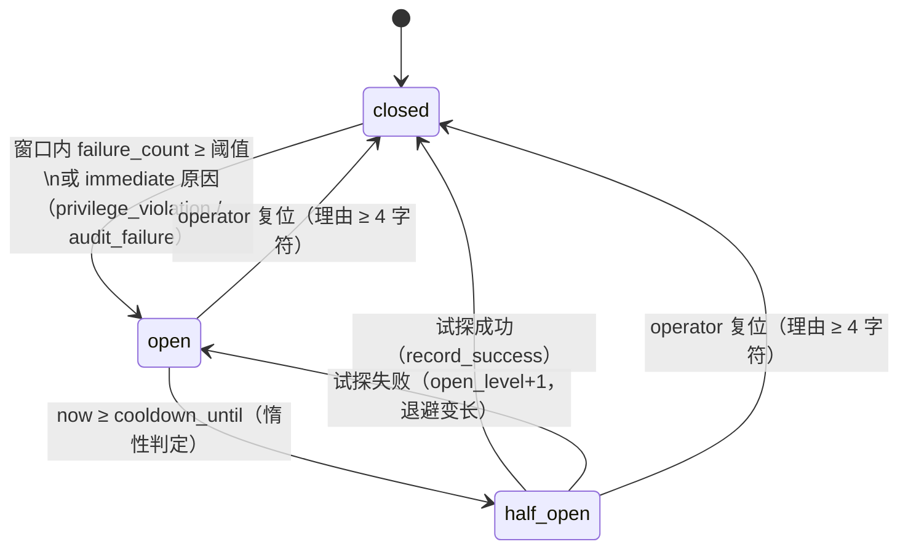

# ADR-005 写能力熔断策略

| 项 | 值 |
| --- | --- |
| ADR 编号 | ADR-005 |
| 状态 | 已接受（Accepted） |
| 决策日期 | 2026-10-29 |
| 决策范围 | 写能力熔断的判定口径（阈值 / 计数窗口 / 冷却 / 升级退避 / 半开试探）、状态机与合法迁移、作用域、复位权限、存储与乐观锁、fail-closed 边界、接入点与拦截回执 |
| 上位约束 | `docs/AI_Banking_Agent_项目基座文档.md:214`（写熔断「连续 3 次失败后开启，冷却 60 秒，人工关闭后恢复」属**固定实现**）、`:322`（工具白名单 / 风险策略 / 熔断同列「基座固定」）、`:212`（DoD：写熔断开关及原因可查询）、`:242`（审计或写沙箱不可用时写请求必须被拒）；架构 `:199`（审计 / 风控 / 审批不可用时写操作 fail-closed，引 ADR-004 上位约束同一条） |
| 需求依据 | PRD §8.4 安全五机制之「异常熔断」（经开发文档阶段 1「五类触发源」对齐，依据行 `:238`） |
| 工作契约 | `docs/AI_Banking_Agent_缺失内容补齐开发文档.md` 阶段 1 熔断与安全锁定（D01）｜3 人日；含勘误 E2（**不新增错误码**，拦截复用 `NOT_READY_001`）、E3 / E4（端点路径与 `/api/v1` 前缀由基座冻结，只能「落地」不能另起） |
| 配套设计 | `docs/AI_Banking_Agent_人工介入中断设计说明.md` §12（门禁时序）；`docs/AI_Banking_Agent_数据库设计文档.md` §10（两表结构）；`docs/AI_Banking_Agent_数据库实施说明.md` §10（迁移执行与验证 SQL） |
| 影响实现 | 新增 `Struct_of_Agent/common/circuit_breaker.py`、`Struct_of_Agent/web_test/api_circuit_breaker.py`、`migrations/versions/0007_circuit_breaker.py`；修改 `Struct_of_Agent/common/hitl.py`、`Struct_of_Agent/R1..R6/graph.py`、`Struct_of_Agent/supervisor.py`、`Struct_of_Agent/web_test/server.py` |

---

## 1. 背景

基座把熔断写进了固定实现（`:214`「写熔断在连续 3 次失败后开启，冷却 60 秒，人工关闭后恢复」），也把「写熔断开关及原因可查询」写进了 DoD（`:212`）。但「一句话规格」在实现层至少留下五个必须由 ADR 决定的空洞：

1. **作用域未定义**。「连续 3 次失败」是哪个范围的连续？如果不带 `tenant + user + capability`，一个用户在 R4 卡片上连续失败三次会把他的转账一起锁死，甚至把整个演示租户的写能力锁死——保护动作本身变成了大范围故障。
2. **状态无法跨进程存活**。若熔断状态只是一个进程内变量，`uvicorn --reload` 一重启就遗忘，事故期间重启等于自动放行；而「人工关闭后恢复」要求状态能被 operator 看见、被人复位，这必须是持久对象。
3. **半开与升级退避未定义**。冷却 60 秒到期后如果再失败，是继续 60 秒还是应该退避？不定义就会出现「每 60 秒撞一次」的抖动；同时半开必须是**有限试探**，否则打开一次就全量放行，等于没有熔断。
4. **失败如何判定、失败来自哪里**。写工具抛异常、回执 `failed`、注入命中、越权命中、审计写失败——这些事件的严重程度不同（有的该计数、有的该零容忍），不能都塞进同一个计数器。
5. **熔断与人工复核的先后**。阶段 1 的第 1 个接入点原本写成「`evaluate` 通过后、执行前」，这会让一条**已经坏掉的写路径**在每次请求时仍然建案、写 `hitl_case`、写审计，把故障放大成数据库写压力，并且持续打扰本该早就知道「这条路径坏了」的审核员。

此外还有一条硬约束：拦截必须复用基座冻结清单里已有的 `NOT_READY_001`，**不得新增错误码族**（勘误 E2）。这决定了本 ADR 的拦截语义只能是「未就绪 / 暂时不可用」，不能自造 `CIRCUIT_OPEN_001`。

上面五条里，第 1、2、3 条决定状态机与存储，第 4 条决定原因码分类，第 5 条决定接入点顺序。

## 2. 决策

### D1 作用域 = `tenant + subject(user) + capability`

- 一行熔断状态的身份是 `(tenant_id, subject_type, subject_id, capability)`，即 0007 主键。
- `subject_type` 只有两个取值：`user` / `tenant`（迁移 CHECK 固定）。本阶段落地的是 **`user`** 维度（`subject_id` 取当前会话 / 用户维度），`tenant` 预留给「整租户写能力熔断」这类更粗粒度的停机动作。
- `capability` 只有 6 项（迁移 CHECK 固定）：`write:transfer`、`write:card`、`write:wealth`、`write:subscribe`、`write:gift`、`code_compute`。
- 因此「R4 卡片坏了」不会影响 R1 转账；「某个用户转账坏了」不会影响其他用户。

### D2 三态状态机，合法迁移封闭

`closed` / `open` / `half_open` 三态，迁移只有 §3 矩阵里那 6 条。要点：

- `closed → open`：窗口内失败计数达到阈值，**或**命中零容忍原因（`immediate=True`）。
- `open → half_open`：**惰性判定**——冷却到期后由下一次读 / 判定触发，不靠后台定时器（与 ADR-004 认领 TTL 的惰性回收同一取向）。
- `half_open → closed`：试探成功（`record_success`）。
- `half_open → open`：试探失败，`open_level` 递增，冷却按退避阶梯变长。
- `open`/`half_open` 只能被 operator 复位回 `closed`；没有「自己变回去」的路径。

### D3 计数窗口 300 秒，成功即清零

- `failure_count` 只在当前窗口内累加；`window_started_at` 记录窗口起点，窗口 `300` 秒（`window_seconds()`）。
- 窗口过期后计数从 0 重新开始——避免「上周失败两次 + 今天失败一次」被算成连续三次。
- `record_success` 把 `failure_count` 清零并关闭窗口：连续失败才开，中间有一次成功就说明路径还活着。

### D4 升级退避：60 → 120 → 240 → 480 → 900 秒，超出取 900

- 首次开启的冷却就是基座固定的 60 秒（`cooldown_seconds()`）。
- 之后每升级一层取 `BACKOFF_SECONDS[open_level]`，`open_level` 超出退避表长度时取表尾 900 秒（`backoff_for()`）。
- `open_level` 单调递增且 `>= 0`（迁移 CHECK），只在 operator 复位时归零——「复位」是人工确认路径已修复，因此重新从 60 秒起算。

### D5 半开只放行一次（`half_open_at` 作为取用标记）

- 进入 `half_open` 时写 `half_open_at`；`half_open_at` 非空即表示这次试探**已经被取用**。
- 取用期间其他并发请求一律按 `open` 拦截，只有取用者成功才回到 `closed`。这样「冷却到期」不会变成一次瞬时全量放行。

### D6 fail-closed：读不到状态就按 `open` 处理

- 存储读取失败（数据库不可用 / 查询异常）→ 记为 `open`，拦截写路径，并写 `safety.circuit.read_failed` 审计事件。
- `version` 乐观锁冲突 → 重试 **1 次**，仍冲突则按 `open` 处理。
- 理由与架构 `:199`、基座 `:242` 同向：**不知道是否安全时，写操作不执行**。这里刻意选择了「宁可误锁也不误放」。

### D7 原因码分两类：计数类与零容忍类

| 原因码 | 语义 | 处置 |
| --- | --- | --- |
| `write_tool_failure` | 写工具抛异常 / 回执失败 | 计数，达到阈值开启 |
| `prompt_injection` | 内容审核命中注入/越权 | 经 `record_violation` **立即**开启 |
| `privilege_violation` | 归属 / 权限校验拒绝 | **立即**开启（零容忍） |
| `audit_failure` | 审计写入失败 | **立即**开启（零容忍） |
| `unknown_result` | 回执 unknown / 超时未确认 | **不熔断**：仅记录原因码，走「先查后决 / 待核」既有链路 |
| `operator_reset` | operator 复位 | 归零并回 `closed` |

- 模块里零容忍集合是 `IMMEDIATE_REASONS = {privilege_violation, audit_failure}`；同时 `record_violation(reason_code, ..., capability=None)` 在**不带 capability** 时对全部写能力按 `immediate` 语义开启——这正是 `supervisor.py` 注入命中时的调用方式，所以「注入命中一次 → 6 项写能力同时 `open`」。
- 口径说明：开发文档阶段 1 的触发源表把 `prompt_injection` 写成「计数（3 次）开启」，而落地实现走的是 `record_violation` 的零容忍通道（一次即开）。本 ADR 按**已实现并已验证**的口径记录，差异与建议见 §6.6、§7.3。

### D8 复位只有 `ops_admin` + 必填理由，且必须署名

- 端点 `POST /api/safety/circuit-breakers/{capability}/reset`（契约别名 `POST /api/v1/safety/circuit-breaker/reset`）。
- 仅 `ops_admin`；`risk_reviewer` 也不能复位——避免「审核者即断路器操作者」。
- 必须带 `X-Operator` 署名（缺 → `403 operator_required`），理由去空白后 `< 4` 字符 → `400 reason_required`，两者都要能回答审计里的「谁、为什么放开业务」。
- 复位成功递增 `version` 并写 `safety.circuit.reset` 审计事件，原因码 `operator_reset`。

### D9 只挂写路径，只读永不拦截

- 是否参与熔断由「工具名 → capability」的白名单决定（`WRITE_TOOL_CAPABILITIES`，19 条写工具）。
- 未登记的工具（所有查询 / 只读工具）`capability_for_tool` 返回 `None`，直接放行，**任何状态都不拦**。
- R2 账单域的 `record_consumption`（记账）**不在白名单内**：能力枚举由 0007 固定为 6 项，账单记账不参与熔断。

## 3. 状态机与参数

### 3.1 状态机



同一条路径的 ASCII 版本（便于终端阅读与粘贴进答辩材料）：

```
                failure_count ≥ 3  /  immediate 原因
   ┌────────┐ ────────────────────────────────────► ┌────────┐
   │ closed │                                       │  open  │
   └────────┘ ◄──────────────────────────────────── │ (L0/1/ │
        ▲         试探成功 / operator 复位            │ 2/3/4) │
        │                                            └────────┘
        │                                                 │
        │                                           冷却到期（惰性）
        │                                                 ▼
        │        operator 复位                     ┌───────────┐
        └───────────────────────────────────────── │ half_open │
                                                   └───────────┘
                                                         │
                                     试探失败（open_level+1，退避变长）
                                                         └──► open
```

### 3.2 合法迁移矩阵（唯一真相）

| # | from | to | 触发 | 触发者 | `reason_code` |
| --- | --- | --- | --- | --- | --- |
| 1 | `closed` | `open` | 窗口内失败计数达阈值 / `immediate=True` | 系统（判定路径） | `write_tool_failure` / `prompt_injection` / `privilege_violation` / `audit_failure` |
| 2 | `open` | `half_open` | `now >= cooldown_until`，`half_open_at` 取用 | 系统（惰性，读或判定时） | 沿用原 `reason_code` |
| 3 | `half_open` | `closed` | 试探成功 | 系统 | — |
| 4 | `half_open` | `open` | 试探失败，`open_level + 1` | 系统 | `write_tool_failure` 等 |
| 5 | `open` | `closed` | operator 复位 | `ops_admin` + `X-Operator` | `operator_reset` |
| 6 | `half_open` | `closed` | operator 复位 | `ops_admin` + `X-Operator` | `operator_reset` |

其余组合非法：`closed → half_open`（没有冷却就不可能半开）、`half_open → half_open`（第二次取用一律按 `open` 拦）、以及任何「从 `open` 直接放行」的路径。

### 3.3 参数表（含来源）

| 参数 | 取值 | 来源 | 可调入口 |
| --- | --- | --- | --- |
| 连续失败阈值 | 3 次 | **基座 `:214` / `:322` 固定实现** | `BANK_AGENT_CIRCUIT_FAILURE_THRESHOLD` |
| 首次冷却 | 60 秒 | **基座 `:214` 固定实现** | `BANK_AGENT_CIRCUIT_COOLDOWN_SECONDS` |
| 人工复位后恢复 | 仅 operator + 必填理由 | **基座 `:214`「人工关闭后恢复」** | — |
| 计数窗口 | 300 秒 | 阶段 1 设计新增 | `BANK_AGENT_CIRCUIT_WINDOW_SECONDS` |
| 半开试探次数 | 1 次 | 阶段 1 设计新增（`half_open_at` 标记取用） | — |
| 升级退避 | 60 → 120 → 240 → 480 → 900 秒，超出取 900 | 阶段 1 设计新增（`BACKOFF_SECONDS`） | — |
| 判定缓存 | 5 秒（进程内） | 阶段 1 设计新增 | `BANK_AGENT_CIRCUIT_CACHE_TTL_SECONDS` |
| 作用域 | `tenant + subject(user) + capability` | 阶段 1 设计新增（参数行） | — |
| 能力枚举 | 6 项：`write:transfer` / `write:card` / `write:wealth` / `write:subscribe` / `write:gift` / `code_compute` | 0007 迁移 CHECK 固定 | — |
| 拦截错误码 | `NOT_READY_001`（复用，不新增码族） | 开发文档勘误 E2 + 基座 `:142` 冻结清单 | — |
| 复位理由长度 | ≥ 4 字符（去空白后） | 设计新增（`MIN_REASON_LENGTH`） | — |
| 总开关 | 默认开启；`0`/`false`/`no`/`off` 才关闭 | 设计新增（演示开关，安全默认开启） | `BANK_AGENT_CIRCUIT_BREAKER_ENABLED` |
| 存储后端 | 默认数据库；`memory` 仅供单测 / 离线 | 设计新增 | `BANK_AGENT_CIRCUIT_BREAKER_STORE` |

> 参数一律走环境变量而非写死在调用点：演示环境可以现场演示「3 次失败就锁」，而不必改代码。非法值（非正整数）退回默认并记警告，不静默变成 0。

## 4. 存储

### 4.1 两张表（`0007_circuit_breaker`）

| 表 | 职责 |
| --- | --- |
| `app.circuit_breaker_state` | 每个 `(tenant, subject, capability)` 一行当前状态；`version` 乐观锁；`half_open_at` 记录试探是否已取用 |
| `app.circuit_breaker_event` | 状态迁移事件，**只追加**（UPDATE / DELETE / TRUNCATE 被触发器拒绝） |

字段级定义见 `docs/AI_Banking_Agent_数据库设计文档.md` §10，执行与验证见 `docs/AI_Banking_Agent_数据库实施说明.md` §10，本文不重复。

### 4.2 存储一致性

- **乐观锁**：所有迁移走 `UPDATE ... WHERE version = :expected`，`version + 1`；冲突重试 1 次后按 `open` 处理（D6）。
- **两个实现**：`SqlStore`（读写 0007 两表，运行时默认）与 `MemoryStore`（进程内存，供无 PostgreSQL 的单元测试）；`configure_store()` / `get_store()` / `set_clock()` 供测试注入。
- **RLS**：两表 `ENABLE` + `FORCE ROW LEVEL SECURITY`，应用写入必须在事务内注入 `app.tenant_id`，因此熔断状态天然按租户隔离，不可能被另一个租户的请求读到或改到。
- **刻意不建到 `app.tenant` 的外键**：安全状态要比业务行活得久（业务数据被 `db.reset` 清理后，熔断事件仍应是可查的安全证据），同时 `db.reset` 与测试清库里的 `TRUNCATE app.* CASCADE` 不能因为熔断表的外键顺序而失败。代价是「租户存在性」不由数据库保证，由服务端的租户上下文（`default_tenant_id()`）保证。

### 4.3 缓存与失效

- 判定结果在进程内缓存 **5 秒**；写操作（迁移 / 复位 / 计数）后立即失效对应 key，因此「复位后下一次请求立刻放行」不依赖缓存过期。
- 缓存只缓存**判定结果**，不缓存「写路径健康」的承诺：读失败时缓存不会掩盖故障，仍按 `open` 处理。

## 5. 接入点与时序

### 5.1 接入点清单

| # | 位置 | 动作 |
| --- | --- | --- |
| 1 | `common/hitl.py: intercept()` | 第一行先过 `breaker_gate(tool_name)`：被熔断挡下**直接返回阻断回执，不建案** |
| 2 | `common/hitl.py: observe_tool_result()` | 供各图节点回报真实执行结果：成功 → `record_success`，失败 → `record_failure(write_tool_failure)` |
| 3 | `R1..R6/graph.py` 六个 `_tools_node` | 工具执行后调用 `hitl.observe_tool_result(name, ok=..., detail=...)` |
| 4 | `supervisor.py: _moderate_input()` | 内容审核命中且 `category ∈ {prompt_injection, privilege_escalation}` → `circuit_breaker.record_violation(...)`，一次即令全部写能力 `open` |
| 5 | `web_test/api_circuit_breaker.py` | 状态查询、operator 复位、`/health/capabilities`、契约别名 |
| 6 | `web_test/server.py` | 注册上述路由 |

### 5.2 判定时序（写路径）

```
工具调用前
  hitl.intercept(tool_name, args)
    ├─ 0. circuit_breaker.guard_write_tool(tool_name)      ← 阶段 1 新增，先于策略
    │     ├─ 非写工具            → None（放行）
    │     └─ 写工具且 open/half_open(已取用) → 阻断回执 dict（NOT_READY_001，
    │                                           detail 含 capability/state/retry_after）
    ├─ 1. HITL 策略判定（evaluate）→ 未命中 → 放行
    ├─ 2. 命中且存在已批准案件 → 消费之（resume / 存档回执）
    └─ 3. 否则建案（hitl_required）
工具执行后
  hitl.observe_tool_result(name, ok, detail)
    ├─ ok  → record_success(capability)   （清零）
    └─ !ok → record_failure(write_tool_failure)（计数 → 阈值开启）
```

**顺序的理由**：熔断关注「这条写路径是否已经坏了」，HITL 关注「这一笔是否高风险、要不要人工批」。路径已经坏了的时候，继续建案只会把故障放大成数据库写入 + 人工队列噪音，所以**先熔断、后策略**。细节见 HITL 设计说明 §12。

### 5.3 HTTP 端点

| 端点 | 允许角色 | 说明 |
| --- | --- | --- |
| `GET /api/safety/circuit-breakers` | `user` / `risk_reviewer` / `ops_admin` | `user` 必须带 `?session_id=` 且只看本人（否则 `403 session_required`）；可选 `state` 过滤 |
| `POST /api/safety/circuit-breakers/{capability}/reset` | 仅 `ops_admin` | 缺署名 `403 operator_required`；理由 `< 4` 字符 `400 reason_required`；未知能力 `400 unknown_capability`；`expected_version` 冲突 `409 version_conflict`；存储异常 `503 circuit_unavailable` |
| `GET /health/capabilities` | 公开 | `enabled` / `writes_enabled` / `degraded` / `open` / `half_open` / `total` / `items` / `scope`；状态不可读 → `503` |
| `GET /health/circuit-breaker` | 契约别名（基座冻结路径） | 本人可见自身，`risk_reviewer`/`ops_admin` 可见全部 |
| `POST /api/v1/safety/circuit-breaker/reset` | 契约别名 | body `{capability, user_id?, session_id?, reason, expected_version?}` |
| `GET /health/ready` | 公开 | DB 可连 + 迁移版本匹配 + 审计可写，否则 `503 NOT_READY_001` |

- 身份统一走 `X-Role`（`user` / `risk_reviewer` / `ops_admin`）+ `X-Operator`（署名）；响应统一 `{ok, message, error_code, data}`。
- 拦截回执 `code = NOT_READY_001`，`detail` 含 `capability` / `state` / `retry_after`；**不新增错误码族**（E2）。
- `/health/capabilities` 与 `/health/live` 的区别：前者**如实**反映业务可用性（任一能力 `open` 时 `degraded=true`），后者只证明进程活着。把「不知道」当不安全（读不到就 503），是 fail-closed 在健康探针上的同一取向。

## 6. 取舍与替代方案

### 6.1 备选 A：只在前端做「写操作已暂停」提示

否决理由：前端提示不是安全边界（架构 §10 禁止以前端过滤替代服务端隔离）；刷新页面、直接调用 API、或换一个客户端就绕过了。熔断必须在判定入口（`intercept`）与存储（数据库状态）上。

### 6.2 备选 B：整个租户一个开关（`subject_type='tenant'` 全局锁）

否决理由：基座要求的是「写能力熔断」，粒度应对应**能力**。全局锁会把「R4 卡片坏」升级为「整个演示环境不能转账」，一次演示事故变成一次全线事故。`subject_type='tenant'` 保留在枚举里（0007 CHECK 已允许），只作为将来「整租户停机」的显式动作，不作为默认行为。

### 6.3 备选 C：后台定时器扫描冷却到期，主动把 `open` 推成 `half_open`

否决理由：多一个不可审计的并发源（与 ADR-004 拒绝「认领过期定时器」同一取向）。惰性判定（下次读 / 判定时按 `cooldown_until` 计算）语义等价、天然幂等、进程重启也不会漏。代价是「状态可能停留在 `open` 直到有人访问」，而状态查询端点本身就会触发判定，运维看一次就够。

### 6.4 备选 D：新增 `CIRCUIT_OPEN_001` 专用错误码

否决理由：直接违反勘误 E2——基座 `:142` 的错误码清单已冻结，新增码族要改基座契约并走 ADR。而且从调用方视角，「能力暂时不可用（未就绪）」与「熔断」是同一类可重试语义，复用 `NOT_READY_001` 反而让前端/探针的行为统一：都是「现在别写，稍后或找 operator」。

### 6.5 备选 E：用进程内计数器（或缓存）作为唯一状态源

否决理由：`--reload` 或崩溃重启即遗忘，事故期间重启等于自动放行；且「人工关闭后恢复」需要一个 operator 能看见并复位的持久对象。`MemoryStore` 保留下来只服务无 PostgreSQL 的单元测试（`configure_store` 注入），运行时默认 `SqlStore`。

### 6.6 备选 F：把 HITL 策略放在熔断之前（按开发文档接入点 1 的原措辞「`evaluate` 通过后、执行前」）

否决理由：写路径已坏时，每次请求仍会建案 + 写 `hitl_case` + 写审计，把断路器故障放大成数据库写压力，并且持续给审核员投递「注定执行不了」的案件。落地实现改为**第一行先过 `breaker_gate`**；被熔断挡下时不建案、不打扰人工。开发文档的措辞差异与 `prompt_injection` 计数的差异一并列在 §7.3，建议回写开发文档阶段 1。

## 7. 后果与风险

### 7.1 正面

| 收益 | 说明 |
| --- | --- |
| 坏路径不再放大故障 | 阈值达到后写请求**零执行**、零建案、零人工打扰；数据库只多一行状态更新与一条事件 |
| 状态可查、可复位、可追溯 | `/health/capabilities` 如实标 `degraded`；`app.circuit_breaker_event` 只追加，谁在什么时候因为什么放开业务都有记录 |
| 隔离粒度正确 | `capability` 维度让「卡片坏」不影响「转账」；`user` 维度让一个用户的问题不外溢 |
| 抖动被退避吸收 | 半开一次试探 + 60→900 秒退避，避免「每 60 秒撞一次」 |
| 未知即不安全 | 存储读失败、乐观锁连续冲突都按 `open`，与架构 `:199` 同向 |
| 只读始终可用 | 熔断期间用户仍能查余额、查流水、看报告，「锁写入」不等于「锁服务」 |

### 7.2 负面与代价

| 代价 | 缓解 |
| --- | --- |
| 误锁会造成写能力短暂不可用 | 半开试探 + operator 复位；拦截回执带 `retry_after`，前端显示恢复时间而不是报错堆栈 |
| 复位成为人工依赖 | 复位路径有明确端点与错误码（`operator_required` / `reason_required` / `version_conflict`），不依赖改数据库 |
| 多一次读（缓存 5 秒） | 判定缓存 + 只缓存判定结果；写后立即失效，不影响「复位即时生效」 |
| 事件表只追加会让表持续增长 | 当前规模（演示环境）可忽略；清理属受控运维流程，不在本阶段 |
| 惰性判定意味着状态可能「停留在 open」直到有人访问 | 状态查询端点本身触发判定；前端横幅定期拉 `/health/capabilities` |

### 7.3 风险与未决项

| 编号 | 风险 / 未决 | 描述 | 处理 |
| --- | --- | --- | --- |
| R-1 | 注入零容忍可能被用来「自锁」 | 构造一次注入命中即令本人 6 项写能力 `open`，用户可能以此拒绝服务自己 | 只影响该 `tenant+user` 的写路径，只读不受影响；operator 一条复位即恢复；事件流留痕，滥用可识别 |
| R-2 | 与开发文档触发源表的口径差异 | 开发文档把 `prompt_injection` 写成「计数（3 次）开启」，落地为一次即开（`record_violation` 零容忍通道；接入点也从「`evaluate` 之后」前移到「`intercept` 第一行」） | 按已实现并已验证的口径记为本文 D7 / §6.6，建议回写开发文档阶段 1 的两处措辞 |
| R-3 | 是否给 `audit_failure` 单独更高优先级 | 审计不可用时按 D7 立即开启，与「审计不可用则写操作 fail-closed」重复保护 | 保留双保护：审计门禁先拒，熔断再把写路径锁住；两层都不依赖对方 |
| R-4 | `code_compute` 尚无真实触发点 | 能力枚举含 `code_compute`（阶段 2 沙箱落地后接管） | 迁移与模块已就位；沙箱接入时复用同一 `record_failure/require_closed`，不新增枚举 |
| R-5 | 计数窗口 300 秒是否合理 | 窗口过短会误锁、过长会掩盖间歇性故障 | 首版 300 秒 + 环境变量可调；`BANK_AGENT_CIRCUIT_WINDOW_SECONDS` 供演示现场调整 |

## 8. 验证

### 8.1 冒烟验证（真实 PostgreSQL，演示库已 `alembic upgrade head` 到 `0007_circuit_breaker`）

| 编号 | 验证内容 | 实测结果 |
| --- | --- | --- |
| V1 | 正常写工具 → `closed` | 通过：状态 `closed`，写工具正常执行 |
| V2 | 连续 3 次写工具失败 → `open` | 通过：`failure_count` 达标即 `open`，写 `circuit_breaker_event` 一条迁移事件 |
| V3 | 第 4 次写工具调用被拦截 | 通过：回执 `NOT_READY_001`，`detail.retry_after = 60`，**零执行** |
| V4 | 冷却到期 → `half_open` → 成功 → `closed` | 通过：半开只放行一次，成功回 `closed` |
| V5 | 熔断期间只读工具 | 通过：查询类工具不受影响（`capability_for_tool` 返回 `None` 恒放行） |
| V6 | 注入零容忍 | 通过：命中一次后 6 项写能力同时 `open` |
| V7 | operator 复位 | 通过：`ops_admin` + 理由复位成功，`version` 递增，状态回 `closed` |
| V8 | HTTP 端点状态码 | 通过：`200` / `403`（`session_required`、`operator_required` 等）/ `400`（`reason_required`、`unknown_capability`）符合契约 |
| V9 | 事件表只追加 | 通过：对 `app.circuit_breaker_event` 执行 DELETE 被触发器拒绝（`insufficient_privilege`） |

### 8.2 验收对照（开发文档阶段 1）

| 阶段 1 验收 | 本 ADR 对应 |
| --- | --- |
| `alembic upgrade head` 成功 | §4.1（迁移 `0007_circuit_breaker`，已在演示库执行到 head） |
| 3 次写失败 → 状态 `open` | D2 / D3 / §8.1 V2 |
| 第 4 次 503 | D9 + §5.3（拦截复用 `NOT_READY_001`，`detail` 含 `retry_after`） |
| 复位恢复 | D8 / §8.1 V7 |
| 锁定期间查询可用 | D9 / §8.1 V5 |
| 越权一次即锁、审计失败即锁 | D7 零容忍 |

## 9. 相关文档

| 文档 | 关系 |
| --- | --- |
| `docs/AI_Banking_Agent_项目基座文档.md` `:212` / `:214` / `:242` / `:322` | 参数与 DoD 的上位来源（3 次 / 60 秒 / 人工恢复 = 固定实现） |
| `docs/AI_Banking_Agent_缺失内容补齐开发文档.md` 阶段 1（D01）、勘误 E2 / E3 / E4 | 工作契约、错误码与端点路径冻结 |
| `docs/AI_Banking_Agent_人工介入中断设计说明.md` §12 | 门禁时序：熔断先于策略，被挡下不建案 |
| `docs/AI_Banking_Agent_数据库设计文档.md` §10 | `app.circuit_breaker_state` / `app.circuit_breaker_event` 字段、约束、索引、RLS |
| `docs/AI_Banking_Agent_数据库实施说明.md` §10 | 迁移升级/回滚行为、执行方式、验证 SQL |
| `docs/AI_Banking_Agent_安全自评报告.md` §6 | 熔断对注入/越权的零容忍联动与检查结论 |
| `docs/ADR/ADR-004-人工案件冲突与超时规则.md` | 同一取向的先例：惰性判定、`version` 乐观锁、职责分离、fail-closed |

**修订记录**

| 版本 | 日期 | 说明 |
| --- | --- | --- |
| v1.0 | 2026-10-29 | 首版：三态状态机 + 6 条迁移矩阵 + 3 次/60 秒基座参数与设计新增参数（窗口 300 秒、半开 1 次、退避 60→900 秒、缓存 5 秒）+ 两表存储与乐观锁 + fail-closed + 零容忍原因码 + 熔断先于 HITL 的门禁顺序 + 六端点契约 |
