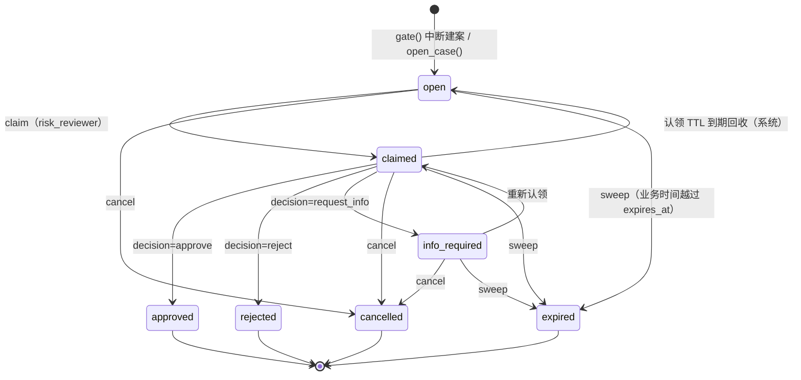
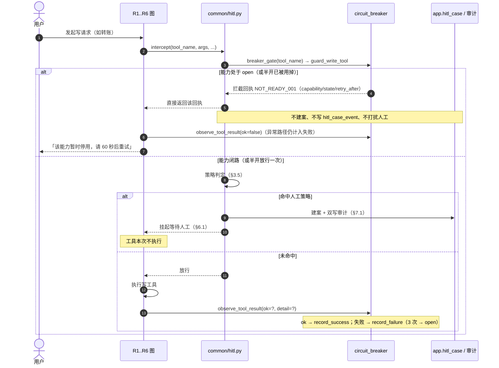

# AI Banking Agent 人工介入中断设计说明

**版本**：v1.0  
**状态**：设计基线（对应实施计划 A1，代码由 B2/C1 落地）  
**适用项目**：`<仓库根>` / `Struct_of_Agent`  
**核心代码**：`Struct_of_Agent/common/hitl.py`、`Struct_of_Agent/web_test/api_hitl.py`（均**需新增**）  
**复用既有能力**：`Struct_of_Agent/db/audit.py` 的 `append_event(...)`、`Struct_of_Agent/db/idempotency.py` 的 `begin_operation(...)`/`complete_operation(...)`、`Struct_of_Agent/db/session.py` 的 `session_scope(engine)`、`Struct_of_Agent/web_test/server.py` 的 `_ok`/`_fail` 响应包  
**配套文档**：`docs/演示时钟与人工介入-实施计划.md`（唯一权威工作契约）、`docs/ADR/ADR-004-人工案件冲突与超时规则.md`、`docs/AI_Banking_Agent_演示时钟设计说明.md`、`docs/AI_Banking_Agent_项目开发总架构文档.md`、`docs/AI_Banking_Agent_数据库设计文档.md`

本文说明「人工介入中断（HITL）」怎么落：**谁**能决定、**怎么**独占、**什么时候**过期、**超时**怎么办、**批准后**怎么安全地恢复执行。表名、列名、API 路径、状态与事件枚举以实施计划为准；与计划不一致处汇总在 §11，正文不私自改契约。

## 1. 背景与需求追溯

P0 要求「最小人工复核」，其准确性取决于三件事：**中断是真的中断**（不执行副作用）、**案件是真的独占**（不会双花）、**超时是真的 fail-closed**（不会自动放行）。三者只要有一样落空，「人工复核」就退化成一段安慰性文案。

| 需求/约束 | 原文位置 | 本设计如何满足 |
| --- | --- | --- |
| P0 含「最小人工复核」「未知结果处理」 | `docs/AI_Banking_Agent_需求规格说明书.md:50` | 独立能力：`/api/hitl/*` 六个接口 + 案件卡片 + 案件队列；可单独路由、单独验收、单独停用（PRD `:119`） |
| 「命中人工策略时创建**单案件、单审核员**的人工复核，审核员只能**通过、拒绝或补件并填写理由**」 | `docs/AI_Banking_Agent_需求规格说明书.md:142` | 单案单认领（`assignee` 唯一）+ `version` 乐观锁；决策三值 `approve`/`reject`/`request_info`，后两者 `note` 必填（§3、§5） |
| 「人工通过不能代替用户确认，事实变化后必须重新评估」 | `docs/AI_Banking_Agent_需求规格说明书.md:144` | 批准 ≠ 执行：`resume` 前校验 `proposal.user_confirmation` 有效性与事实重查，缺失/失效 → 回到「待确认」（§6.5、§11 O-3） |
| 「复杂批量分配、多级审批和复杂 SLA 属于 P1」 | `docs/AI_Banking_Agent_需求规格说明书.md:144` | 非目标：不做多级审批、批量分配、审批组、升级链（§2.2） |
| 「未知结果必须查询原操作，不能直接重试；无法安全确定时创建人工案件。人工审核只提供最小闭环」 | `docs/AI_Banking_Agent_需求规格说明书.md:240` | `reason_code=unknown_result` 的建案路径：先查原操作，仍不确定才建案；案件只提供通过/拒绝/补件 + 理由 + 审计 |
| 风控审核员「处理分配给自己的单案件：通过、拒绝或补件并填写理由；不能代替用户确认」 | `docs/AI_Banking_Agent_需求规格说明书.md:73` | `X-Role=risk_reviewer` 才能 `claim`/`decision`；非认领人 403/409；不能以审批替代用户确认（§5.1、§6.5） |
| 管理员/运营「管理演示配置、重置数据、查看脱敏轨迹和案件；**不能审批**或代替用户执行金融写入」 | `docs/AI_Banking_Agent_需求规格说明书.md:74` | `ops_admin` 可读案件（脱敏）、不可 `claim`/`decision` → `403 role_not_allowed` + 越权审计 |
| 会话/任务/工具调用/审计事件绑定演示租户与所有者；人工案件按最小必要范围可见 | `docs/AI_Banking_Agent_需求规格说明书.md:76` | 案件带 `tenant_id`/`owner_principal_id`/`session_id`；`user` 只能读本人 `session_id` 的案件（§5.1、§11 O-4） |
| 红色动作「规则检查+确认+模拟 MFA，命中策略时人工复核；不得自动放行」 | `docs/AI_Banking_Agent_需求规格说明书.md:220` | `risk_level ∈ {green,yellow,red}` 由策略判定；`red` 命中阈值 → `reason_code=high_risk_write` 中断；超时绝不自动批准（ADR-004 §4.1） |
| 危险输入/越权/伪造确认必须阻断并审计；审计不可用时禁止写操作 | `docs/AI_Banking_Agent_需求规格说明书.md:236`、`:27` | 越权与非法迁移都写 `audit.event`；审计写失败 → 事务回滚 → `503 audit_unavailable` |
| 「写操作确认前零执行」「相同请求不重复产生副作用」 | `docs/AI_Banking_Agent_需求规格说明书.md:265` | `Interrupt` 时不执行任何工具；`resume` 用 `proposal.idempotency_key` 走既有幂等层（§6.2） |
| 审计/风控/审批不可用时写操作 fail-closed | `docs/AI_Banking_Agent_项目开发总架构文档.md:199` | 案件状态机与审计同事务；`approve` 时若安全门不可用 → 拒绝执行并保留案件（§6.2 步骤 6） |
| checkpoint 只保存编排状态，恢复前必须重查易变事实并重新通过安全门 | `docs/AI_Banking_Agent_项目开发总架构文档.md:115` | `resume` 一律重走安全门 + 重查事实，不复用中断前的事实结论（§6.2） |
| 跨步骤任务以业务任务记录、checkpoint、沙箱操作记录三者关联 | `docs/AI_Banking_Agent_项目开发总架构文档.md:117` | 案件保存 `task_id` + `graph_thread_id` + `proposal`，形成三点关联 |
| 「人工案件冲突/超时规则」列为待确认事项 | `docs/AI_Banking_Agent_项目开发总架构文档.md:216` | 由 `ADR-004` 记录：单认领 + `version` + TTL 回收 + 幂等 + SLA 900 秒 fail-closed |
| 「人工复核和用户确认分离，不能被 Agent/UI/配置绕过」 | `docs/AI_Banking_Agent_项目开发总架构文档.md:195` | 服务端强制角色；前端身份切换只是 UX，绕过前端仍被 403（§9 R-7） |
| 中断/恢复/重规划/可追踪性 | `docs/文档构建大纲.md:71` | 案件事件流 `hitl_case_event.seq` 单调，可与 `audit.event` 交叉回放 |
| 时间必须带时区 | `docs/AI_Banking_Agent_需求规格说明书.md:246` | `real_at`/`business_at` 均 `timestamptz`，SLA 一律按业务时钟（§4、§6.4） |

## 2. 目标 / 非目标

### 2.1 目标

1. **真中断**：写操作在闸门处被拦下时，**零副作用**；唯一留下的痕迹是 `app.hitl_case` 与审计。
2. **可认领**：`risk_reviewer` 独占认领、TTL 到期可被别人回收。
3. **可决策**：通过 / 拒绝 / 补件三种，理由必填（补件与拒绝），决策幂等。
4. **可恢复**：批准后从存档 proposal 恢复执行，且**只执行一次**（幂等键），并重走最终安全门。
5. **可超时**：SLA 默认 15 分钟，按业务时钟计算；超时 → `expired`，fail-closed 不执行，通知用户可重新发起。
6. **可审计**：每一次迁移写 `audit.event` + `hitl_case_event`，同事务，含 `real_at`/`business_at`。
7. **可演示**：聊天流内嵌「等待人工处理」卡片、抽屉式案件队列、顶栏待处理数量徽标、身份切换下拉。

### 2.2 非目标（明确不做）

| 不做 | 原因 |
| --- | --- |
| 多级审批 / 审批组 / 会签 / 升级链 | 需求 `:144` 明确属 P1 |
| 批量分配案件、按负载均衡派单 | P1；首版只有「自助认领」 |
| 复杂 SLA（分档、工作日历、暂停节假日） | P1；首版统一 `sla_seconds=900` + 环境变量 |
| 后台常驻定时器 / 消息队列驱动过期 | 演示环境保持单进程；过期由 `POST /api/hitl/sweep` 与惰性判定驱动 |
| 跨租户/多租户审批中心 | 首版单演示租户 |
| 用人工批准替代用户确认 | 架构 §10 禁止实现清单；本设计显式相反（§6.5） |
| 「超时自动批准」「多操作员并发批准」 | 见 ADR-004 §4.1、§4.2 |
| 真实通知渠道（邮件/IM/短信） | P1；首版用站内消息与卡片状态 |
| 审批留痕的图片签名 / 电子签章 | 非需求 |

## 3. 领域模型与状态机

### 3.1 核心概念

| 概念 | 说明 |
| --- | --- |
| **提案（proposal）** | 本该执行但被挂起的写操作快照：工具名、参数、幂等键、风险级别、面向用户的摘要、用户确认证据 |
| **人工案件（case）** | 提案 + 状态 + 认领信息 + 决策 + SLA，落 `app.hitl_case` |
| **闸门（gate）** | 写操作执行前的判定点，`common/hitl.gate(session, task, proposal)` 返回 `Allow` 或 `Interrupt(case)` |
| **认领（claim）** | `risk_reviewer` 对案件取得独占处理权，带 TTL |
| **恢复（resume）** | 批准后用存档 proposal 重新走安全门执行，等价于「一次带幂等键的首次执行」 |

### 3.2 状态机



### 3.3 合法迁移矩阵（服务层强校验，唯一真相）

| # | from | to | 动作 | 允许角色 | 前置条件 | 领域事件 `action` |
| --- | --- | --- | --- | --- | --- | --- |
| 1 | —— | `open` | `gate()` 中断 / `open_case()` | 系统（由 Agent 运行触发） | 命中人工策略（§3.4） | `create` |
| 2 | `open` | `claimed` | `claim` | `risk_reviewer` | `expires_at > business_now` | `claim` |
| 3 | `info_required` | `claimed` | `claim` | `risk_reviewer` | 同上 | `claim` |
| 4 | `claimed` | `open` | 认领回收 | 系统 | `claim_expires_at <= business_now` | `claim`（`note` 前缀「认领超时自动回收」） |
| 5 | `claimed` | `approved` | `decision=approve` | 当前 `assignee` | `ack=true`；`expires_at > business_now`；`version` 匹配 | `approve` + `resume` |
| 6 | `claimed` | `rejected` | `decision=reject` | 当前 `assignee` | `ack=true`；`note` 非空 | `reject` |
| 7 | `claimed` | `info_required` | `decision=request_info` | 当前 `assignee` | `ack=true`；`note` 非空 | `request_info` |
| 8 | `open` | `cancelled` | `cancel` | `risk_reviewer` / 系统（策略停机） | —— | `cancel` |
| 9 | `claimed` | `cancelled` | `cancel` | `risk_reviewer` / 当前 `assignee` 或系统 | —— | `cancel` |
| 10 | `info_required` | `cancelled` | `cancel` | `risk_reviewer` / 系统 | —— | `cancel` |
| 11 | `open` | `expired` | `sweep` | 系统 | `expires_at <= business_now` | `expire` |
| 12 | `claimed` | `expired` | `sweep` | 系统 | 同上 | `expire` |
| 13 | `info_required` | `expired` | `sweep` | 系统 | 同上 | `expire` |

终态：`approved` / `rejected` / `expired` / `cancelled`。

### 3.4 非法迁移与报错码

| 情形 | HTTP | `error_code` | 是否写审计 |
| --- | --- | --- | --- |
| 从终态发起任何迁移（`approved→*`、`rejected→*`、`expired→*`、`cancelled→*`） | 409 | `invalid_transition` | 是（`hitl.denied`） |
| `open → approved`（未认领直接决策） | 409 | `case_not_claimable` | 是 |
| 非认领人决策（`assignee != X-Operator`） | 409 | `case_not_claimable` | 是 |
| `open → claimed` 时案件已过期（`expires_at <= business_now`） | 409 | `case_expired` | 是（先把案件置 `expired`） |
| 决策时案件已过期 | 409 | `case_expired` | 是 |
| `version` 不匹配（并发改） | 409 | `case_version_conflict` | 否（未产生变更，仅记访问日志） |
| 对已决策案件提交**不同**决策 | 409 | `case_already_decided` | 是 |
| `user` 或 `ops_admin` 调 `claim`/`decision` | 403 | `role_not_allowed` | 是（`hitl.denied`） |
| 缺 `X-Operator` | 403 | `operator_required` | 是 |
| 缺 `ack=true` | 400 | `ack_required` | 否 |
| `reject`/`request_info` 的 `note` 为空 | 400 | `note_required` | 否 |
| `case_no` 不存在 | 404 | `case_not_found` | 否 |
| `user` 读取非本人会话的案件 | 403 | `role_not_allowed` | 是（`hitl.denied`） |
| 审计写入失败 | 503 | `audit_unavailable` | —— 事务回滚，全部不生效 |

### 3.5 触发策略（谁把写操作变成案件）

`gate()` 的判定输入是 `(session, task, proposal)`，输出 `Allow` 或 `Interrupt(case)`。首版策略（常量放 `common/hitl.py`，可后续配置化）：

| 条件 | 结果 | `reason_code` |
| --- | --- | --- |
| 只读查询 / 无副作用草稿 | `Allow` | —— |
| 工具在「需复核白名单」内（转账、理财申购/赎回、额度调整、卡解挂/挂失、代扣撤销、礼品下单、预算预留） | `Interrupt` | `high_risk_write` |
| `risk_level='red'` 且金额 ≥ 阈值（首版 1000 元 = 100000 分，对齐 PRD `:222`） | `Interrupt` | `high_risk_write` |
| 工具返回「结果未知」/超时/连接中断且重查仍无法确定 | `Interrupt` | `unknown_result` |
| 需要人工核验的资料缺失或对不上（如 KYC 名称与账户名不符） | `Interrupt` | `missing_info` |
| 多条策略互相冲突（如限额策略与用户授权冲突） | `Interrupt` | `policy_conflict` |
| 依赖的外部能力降级（沙箱不可用、风控不可用） | `Interrupt` | `tool_degraded` |

要点：

- **`Allow` 也可能被后续安全门拒绝**：闸门只决定「要不要人」，不决定「能不能执行」。
- 命中多个原因时按 `unknown_result > tool_degraded > policy_conflict > missing_info > high_risk_write` 取第一个（不确定性优先，因为它最不能自动处理）。
- `risk_level` 由现有权限分级判定（PRD §8.1 绿/黄/红）。**命名注意**：本仓库既有 `risk_level` 用于理财风险测评/产品等级（`db/models_ext.py` 的 `RISK_LEVELS = {"R1".."R5"}`，标签见 `db/scenario_repository.py:68` 的 `RISK_LABELS`）。本设计的 `app.hitl_case.risk_level` 取绿/黄/红三值，与 R1-R5 是**不同维度**，不得混用，也不得把 `R3` 写进人工案件。

## 4. 数据模型

迁移文件：`migrations/versions/0004_demo_clock_and_hitl.py`（**需新增**）；ORM 类加在 `Struct_of_Agent/db/models.py`（B0）。风格对齐既有表：`__table_args__` 内 `CheckConstraint(..., name=...)`、`UniqueConstraint(..., name="uq_<table>_<cols>")`、`ForeignKeyConstraint([...], [...], name="fk_<table>_<col>_<reftable>")`、`Index(...)`、末尾 `{"comment": "中文注释"}`。

### 4.1 `app.hitl_case`

| 列 | 类型 | 可空 | 默认 | 约束/索引/说明 |
| --- | --- | --- | --- | --- |
| `id` | `UUID` | 否 | `gen_random_uuid()` | 主键 `pk_hitl_case`（对齐库设计文档 UUID 主键约定） |
| `case_no` | `VARCHAR(32)` | 否 | —— | 唯一 `uq_hitl_case_case_no`；格式 `HC-YYYYMMDD-XXXXXX`（6 位大写十六进制，源自 `uuid4`，唯一冲突重试 3 次） |
| `tenant_id` | `UUID` | 否 | —— | 补充列（§11 O-4）；对齐 `app.task` 的所有者约定 |
| `owner_principal_id` | `UUID` | 否 | —— | 补充列（§11 O-4）；复合外键 `fk_hitl_case_owner` → `app.principal(tenant_id, id)` |
| `session_id` | `UUID` | 否 | —— | 复合外键 `fk_hitl_case_session` → `app.conversation_session(tenant_id, id)`（与 `Task` 的 `fk_task_session` 同款） |
| `task_id` | `UUID` | 是 | `NULL` | 外键 `fk_hitl_case_task_id_task` → `app.task(id)`；`unknown_result` 类案件可能尚无任务行 |
| `status` | `VARCHAR(16)` | 否 | `'open'` | `CHECK (status IN ('open','claimed','approved','rejected','info_required','expired','cancelled'))` → `ck_hitl_case_status` |
| `reason_code` | `VARCHAR(24)` | 否 | —— | `CHECK (reason_code IN ('high_risk_write','unknown_result','missing_info','policy_conflict','tool_degraded'))` → `ck_hitl_case_reason_code` |
| `reason_text` | `VARCHAR(255)` | 是 | `NULL` | 面向用户/审核员的原因说明（脱敏后） |
| `risk_level` | `VARCHAR(8)` | 否 | —— | `CHECK (risk_level IN ('green','yellow','red'))` → `ck_hitl_case_risk_level`（绿/黄/红，**非** R1-R5） |
| `proposal` | `JSONB` | 否 | —— | 提案快照，结构见 §4.3；**库内保留完整参数**（执行与回放需要），对外一律脱敏 |
| `graph_thread_id` | `VARCHAR(128)` | 是 | `NULL` | 图执行线程标识；两条恢复路径都保留该字段（实施计划 §2.2） |
| `assignee` | `VARCHAR(64)` | 是 | `NULL` | 当前认领人（`X-Operator`） |
| `claimed_at` | `TIMESTAMPTZ` | 是 | `NULL` | 认领时的真实时间 |
| `claim_expires_at` | `TIMESTAMPTZ` | 是 | `NULL` | 认领 TTL 到期时刻（业务时间语义，默认 +300 秒） |
| `decision` | `JSONB` | 是 | `NULL` | 决策快照：`{decision, operator, role, note, business_at, resumed:{...}\|null}` |
| `decided_by` | `VARCHAR(64)` | 是 | `NULL` | 决策人 |
| `decided_at` | `TIMESTAMPTZ` | 是 | `NULL` | 决策时的真实时间 |
| `decision_note` | `TEXT` | 是 | `NULL` | 拒绝理由（`reject` 必填） |
| `info_request_note` | `TEXT` | 是 | `NULL` | 补件说明（`request_info` 必填） |
| `expires_at` | `TIMESTAMPTZ` | 否 | —— | SLA 到期时刻 = `business_at + sla_seconds`；补件后重算 |
| `sla_seconds` | `INTEGER` | 否 | `900` | `CHECK (sla_seconds > 0)` → `ck_hitl_case_sla_positive`；建案时固化 |
| `version` | `INTEGER` | 否 | `1` | `CHECK (version >= 1)` → `ck_hitl_case_version_positive`；乐观锁 |
| `created_at` | `TIMESTAMPTZ` | 否 | `now()` | **真实时间**（建案时刻） |
| `business_at` | `TIMESTAMPTZ` | 否 | —— | 建案时的**业务时间**（`Clock.now()`） |
| `updated_at` | `TIMESTAMPTZ` | 否 | `now()` | 最后一次变更（真实时间） |

补充 CHECK（除枚举列外，保证「状态与字段不打架」）：

| 约束名 | 表达式 | 目的 |
| --- | --- | --- |
| `ck_hitl_case_claimed_fields` | `status <> 'claimed' OR (assignee IS NOT NULL AND claimed_at IS NOT NULL AND claim_expires_at IS NOT NULL)` | `claimed` 必须有认领三件套 |
| `ck_hitl_case_unclaimed_fields` | `status = 'claimed' OR (assignee IS NULL AND claim_expires_at IS NULL)` | 非 `claimed` 不得残留认领信息 |
| `ck_hitl_case_decision_fields` | `status NOT IN ('approved','rejected') OR (decided_by IS NOT NULL AND decided_at IS NOT NULL AND decision IS NOT NULL)` | 终态必须有决策痕迹 |
| `ck_hitl_case_reject_note` | `status <> 'rejected' OR decision_note IS NOT NULL` | 拒绝必须写理由（需求 `:142`） |
| `ck_hitl_case_info_note` | `status <> 'info_required' OR info_request_note IS NOT NULL` | 补件必须写清缺什么 |
| `ck_hitl_case_expiry_range` | `expires_at >= business_at` | SLA 不能早于建案 |

索引：

| 索引名 | 列 | 用途 |
| --- | --- | --- |
| `ix_hitl_case_status_expires_at` | `(status, expires_at)` | **计划强制要求**：SLA 扫描 |
| `ix_hitl_case_session_created` | `(tenant_id, session_id, created_at DESC)` | 会话内案件卡片重建 / `user` 本人可见范围 |
| `ix_hitl_case_assignee_status` | `(assignee, status)` | 审核员「我的案件」与并发认领校验 |

审计字段：`created_at`/`updated_at`（真实）、`business_at`（业务）、`decided_by`/`decided_at`、`assignee`/`claimed_at`。**注意**：`created_at` 是真实时间（实施计划 §2.3 标注 `created_at`(real)），业务时间在 `business_at`，两者不可互相替代。

### 4.2 `app.hitl_case_event`（只追加）

| 列 | 类型 | 可空 | 约束/说明 |
| --- | --- | --- | --- |
| `id` | `BIGSERIAL` | 否 | 主键 `pk_hitl_case_event` |
| `case_id` | `UUID` | 否 | 外键 `fk_hitl_case_event_case_id_hitl_case` → `app.hitl_case(id)`，`ON DELETE RESTRICT` |
| `seq` | `INTEGER` | 否 | 案件内单调序号；唯一 `uq_hitl_case_event_case_id_seq (case_id, seq)`；写前锁案件行取 `max(seq)+1` |
| `action` | `VARCHAR(16)` | 否 | `CHECK (action IN ('create','claim','approve','reject','request_info','cancel','expire','resume'))` → `ck_hitl_case_event_action` |
| `operator` | `VARCHAR(64)` | 否 | 操作者（系统动作记 `system`） |
| `role` | `VARCHAR(16)` | 否 | `CHECK (role IN ('user','risk_reviewer','ops_admin','system'))` → `ck_hitl_case_event_role` |
| `note` | `TEXT` | 是 | 说明/理由（拒绝与补件理由同时镜像在这里，便于单表回放） |
| `real_at` | `TIMESTAMPTZ` | 否 | 真实时间 |
| `business_at` | `TIMESTAMPTZ` | 否 | 业务时间 |

索引：`ix_hitl_case_event_case_seq (case_id, seq)`。只追加：不提供 UPDATE/DELETE 的仓储方法；如需强约束，在 0004 里加与 `audit.event` 同款的拒绝触发器（**需新增**）。

### 4.3 `proposal` JSON 结构

```json
{
  "tool_name": "transfer_by_name",
  "arguments": {
    "amount_fen": 150000,
    "recipient_name": "张*",
    "from_account_masked": "6222****0001"
  },
  "idempotency_key": "hitl-HC-20261028-7F3A21-1",
  "request_hash": "<sha256 hex>",
  "risk_level": "red",
  "summary": "向 张* 转账 1,500.00 元（账户 6222****0001）",
  "agent": "R1",
  "user_confirmation": {
    "message_id": 10233,
    "text_digest": "确认转账 1500 元给张*",
    "business_at": "2026-10-28T15:10:00+08:00",
    "confirmed": true
  },
  "created_business_at": "2026-10-28T15:11:00+08:00"
}
```

- `arguments` 与 `summary` 面向展示时**已脱敏**；原始参数如确需保留，另存 `arguments_raw` 且不出现在任何 API 响应里（§7.3）。
- `idempotency_key` 由建案时生成并固化：`hitl-{case_no}-{attempt}`，`attempt` 从 1 起；恢复执行时不变，保证「同一案件同一提案」只执行一次。
- `user_confirmation` 是本设计新增字段（§11 O-3），用于满足「人工通过不能代替用户确认」。

## 5. 接口契约

统一响应包 `{"ok", "message", "error_code", "data"}`（`server.py` 现有 `_ok`/`_fail`）；下文只画 `data`。

### 5.1 鉴权与职责分离（实施计划 §1.3、§3）

| 接口 | `user` | `risk_reviewer` | `ops_admin` |
| --- | --- | --- | --- |
| `GET /api/hitl/cases` | 仅本人 `session_id`（必须带参） | 全部（可筛选） | 全部（脱敏） |
| `GET /api/hitl/cases/{case_no}` | 仅本人案件 | 全部 | 全部（脱敏） |
| `POST .../claim` | 403 `role_not_allowed` | ✅（限 `open`/`info_required`） | 403 `role_not_allowed` |
| `POST .../decision` | 403 `role_not_allowed` | ✅（限本人认领） | 403 `role_not_allowed` |
| `POST .../cancel` | 403 `role_not_allowed` | ✅ | 403 `role_not_allowed`（运营不能代表用户取消执行类决定） |
| `POST /api/hitl/sweep` | 403 | ✅ | ✅ |

- 头：`X-Role`（缺省 `user`）+ `X-Operator`（缺省视为缺失 → 写操作 403 `operator_required`）。`user` 的 `session_id` 归属用 `tenant_id` + `owner_principal_id` 校验（`db/repository.py` 既有 `self.db.tenant_id/principal_id` 语义，默认 `demo-tenant`/`demo-user`）。
- 前端「身份切换」下拉只是 UX；**服务端不信任前端**（架构 `:195`、§10 禁止以前端过滤替代服务端隔离）。

### 5.2 `GET /api/hitl/cases?status=&session_id=&limit=`

```json
GET /api/hitl/cases?status=open&limit=20
X-Role: risk_reviewer
X-Operator: reviewer-01

200 {"ok": true, "message": "", "error_code": null, "data": {
      "items": [{
        "case_no": "HC-20261028-7F3A21",
        "session_id": "3b0f0d1e-...",
        "task_id": "9a1c...",
        "status": "open",
        "reason_code": "high_risk_write",
        "reason_text": "转账金额 1,500.00 元达到人工复核阈值",
        "risk_level": "red",
        "summary": "向 张* 转账 1,500.00 元（账户 6222****0001）",
        "expires_at": "2026-10-28T15:26:00+08:00",
        "sla_seconds": 900,
        "assignee": null,
        "version": 1,
        "business_at": "2026-10-28T15:11:00+08:00",
        "created_at": "2026-10-28T15:11:03+08:00"
      }],
      "total": 1
    }}
```

- 返回前先做一次惰性判定：`claimed` 且 TTL 到期 → 回收为 `open`；`*` 且 `expires_at <= business_now` → 置 `expired`（§6.4）。这样列表不会显示「已被认领」但其实早已失效。
- `limit` 缺省 20、上限 100（越界 → 400，复用既有 `RequestValidationError` 处理器）。

### 5.3 `GET /api/hitl/cases/{case_no}`

```json
200 {"ok": true, "message": "", "error_code": null, "data": {
      "case": { "case_no": "HC-20261028-7F3A21", "status": "claimed", "assignee": "reviewer-01",
                "version": 3, "reason_code": "high_risk_write", "risk_level": "red",
                "summary": "向 张* 转账 1,500.00 元（账户 6222****0001）",
                "expires_at": "2026-10-28T15:26:00+08:00", "claim_expires_at": "2026-10-28T15:16:00+08:00" },
      "events": [
        {"seq": 1, "action": "create", "operator": "system", "role": "system",
         "note": "命中高风险写策略", "real_at": "2026-10-28T15:11:03+08:00", "business_at": "2026-10-28T15:11:00+08:00"},
        {"seq": 2, "action": "claim", "operator": "reviewer-01", "role": "risk_reviewer",
         "note": null, "real_at": "2026-10-28T15:12:10+08:00", "business_at": "2026-10-28T15:12:07+08:00"}
      ]
    }}
```

### 5.4 `POST /api/hitl/cases/{case_no}/claim`

```json
POST /api/hitl/cases/HC-20261028-7F3A21/claim
{"operator": "reviewer-01"}
200 {"ok": true, "message": "已认领", "error_code": null, "data": {
      "case": {"case_no": "HC-20261028-7F3A21", "status": "claimed", "assignee": "reviewer-01",
               "claimed_at": "2026-10-28T15:12:10+08:00",
               "claim_expires_at": "2026-10-28T15:17:07+08:00", "version": 2}
    }}
```

- 并发认领：`UPDATE ... WHERE case_no=:n AND status IN ('open','info_required') AND version=:v`；`rowcount=0` → 409 `case_not_claimable`（或版本不符时的 `case_version_conflict`）。
- 已被自己认领 → 幂等 200（不新增事件）。

### 5.5 `POST /api/hitl/cases/{case_no}/decision`

```json
POST /api/hitl/cases/HC-20261028-7F3A21/decision
{"operator": "reviewer-01", "decision": "approve", "note": "已电话核实收款人身份", "pin": "000000", "ack": true}

200 {"ok": true, "message": "已批准并恢复执行", "error_code": null, "data": {
      "case": {"case_no": "HC-20261028-7F3A21", "status": "approved", "assignee": null,
               "decided_by": "reviewer-01", "decided_at": "2026-10-28T15:13:40+08:00",
               "version": 4,
               "decision": {"decision": "approve", "operator": "reviewer-01", "role": "risk_reviewer",
                            "note": "已电话核实收款人身份", "business_at": "2026-10-28T15:13:35+08:00"}},
      "resumed": {"executed": true, "tool_name": "transfer_by_name",
                  "task_id": "9a1c...", "receipt": {"status": "succeeded", "amount_fen": 150000},
                  "business_at": "2026-10-28T15:13:36+08:00"}
    }}
```

拒绝示例：

```json
POST .../decision
{"operator": "reviewer-01", "decision": "reject", "note": "收款人信息与账户名不符，拒绝", "ack": true}
200 {"ok": true, "message": "已拒绝，未执行任何操作", "error_code": null, "data": {
      "case": {"case_no": "HC-20261028-7F3A21", "status": "rejected", "version": 4,
               "decision_note": "收款人信息与账户名不符，拒绝"},
      "resumed": null
    }}
```

补件示例：

```json
POST .../decision
{"operator": "reviewer-01", "decision": "request_info", "note": "请补充收款人开户行与关系说明", "ack": true}
200 {"ok": true, "message": "已通知用户补充资料", "error_code": null, "data": {
      "case": {"case_no": "HC-20261028-7F3A21", "status": "info_required", "assignee": null,
               "info_request_note": "请补充收款人开户行与关系说明",
               "expires_at": "2026-10-28T15:28:40+08:00", "version": 4},
      "resumed": null
    }}
```

幂等重放：

```json
200 {"ok": true, "message": "该案件已按首次决定处理", "error_code": null,
     "data": {"case": {...首次快照...}, "resumed": null, "replay": true}}
```

- `decision` 三值：`approve` | `reject` | `request_info`（**实施计划 §3 契约行仍写两值**，见 §11 O-1）。
- `note`：`reject`/`request_info` 必填；`approve` 建议填写。
- `ack=true` 必填（实施计划 §3 第 120 行）。
- `pin`：仅 `risk_level='red'` 时校验模拟 MFA（PRD `:107`「高风险动作用明确确认控件 + 模拟 MFA」）；校验失败 → 403 `mfa_invalid`。默认演示 PIN 由配置项给出（§9 U-5）。
- `expected_version` 可选，用于前端拿着旧快照时明确表达意图。

### 5.6 `POST /api/hitl/cases/{case_no}/cancel`

```json
POST /api/hitl/cases/HC-20261028-7F3A21/cancel
{"operator": "reviewer-01", "note": "用户已改为线下办理"}
200 {"ok": true, "message": "案件已取消", "error_code": null,
     "data": {"case": {"case_no": "HC-20261028-7F3A21", "status": "cancelled", "version": 4}}}
```

取消**只是不执行**：不产生副作用、不自动重试（需求 `:240`「未知结果不能直接重试」）。

### 5.7 `POST /api/hitl/sweep`

```json
POST /api/hitl/sweep
{"now": "2026-10-28T15:27:00+08:00"}
200 {"ok": true, "message": "已过期 2 件", "error_code": null,
     "data": {"expired": ["HC-20261028-7F3A21", "HC-20261028-91B4C2"]}}
```

- `now` 缺省取 `get_clock().now()`（业务时间）；传入值仅用于测试与手工补偿，仍按同一 SQL 条件更新。
- 每个过期案件写 `hitl_case_event(action='expire')` + `audit.event`。

### 5.8 错误码汇总

| `error_code` | HTTP | 语义 | 前端呈现 |
| --- | --- | --- | --- |
| `role_not_allowed` | 403 | 角色无权（含 `user` 读他人案件、`ops_admin` 审批） | 「当前身份无此权限」，提示切换身份 |
| `operator_required` | 403 | 写操作缺 `X-Operator` | 要求填写操作员名 |
| `ack_required` | 400 | 决策缺 `ack=true` | 弹二次确认 |
| `note_required` | 400 | `reject`/`request_info` 缺理由 | 理由输入框标红 |
| `case_not_found` | 404 | `case_no` 不存在 | 刷新队列 |
| `case_not_claimable` | 409 | 未认领就决策 / 非认领人决策 / 已被他人认领 | 提示先认领或刷新 |
| `case_version_conflict` | 409 | `version` 不匹配（并发） | 自动刷新后重试 |
| `case_expired` | 409 | 案件已超时（决策/认领时） | 显示「已超时，未执行；可重新发起」 |
| `case_already_decided` | 409 | 已决策且本次决定不同 | 显示首次结论，不再允许改 |
| `invalid_transition` | 409 | 状态机不允许的迁移 | 刷新案件 |
| `mfa_invalid` | 403 | `pin` 校验失败 | 重新输入 PIN |
| `user_confirmation_missing` | 409 | 恢复时缺有效用户确认 | 回到「待确认」，提示用户重新确认 |
| `audit_unavailable` | 503 | 审计写失败（fail-closed） | 顶部红条，禁止重试写入 |

## 6. 关键流程时序

### 6.1 写操作 → 中断 → 建案

```
用户消息 → Supervisor → R1/R5/R6 图 → 工具调用前 → gate(session, task, proposal)
   │
   ├─ Allow  → 继续走安全门 → 执行 → 写 app.task + audit.event
   └─ Interrupt(case)
        ├─ 1. 同一事务：INSERT app.hitl_case(status='open', reason_code, risk_level,
        │        proposal{工具名, 参数, 幂等键, user_confirmation}, graph_thread_id,
        │        business_at=Clock.now(), expires_at=business_at+sla_seconds)
        │    + INSERT app.hitl_case_event(seq=1, action='create', operator='system', role='system')
        │    + append_event(action='hitl.case.create', resource_type='hitl_case', resource_id=case.id)
        ├─ 2. 本轮结果标记「已挂起等待人工处理」（task.status 见 §11 O-6），**不执行任何工具**
        ├─ 3. 回复用户：「已转人工复核，案件号 HC-…，预计 15 分钟内处理」
        └─ 4. 前端聊天流渲染「等待人工处理」卡片（§7.4）
```

审计写入点：① `hitl_case` 与 `hitl_case_event` 与 `audit.event` 三者同一事务（`append_event` 只 `flush`，由 `session_scope` 提交）；② 任何一步失败 → 全部回滚，写操作**不会**被执行，也不会留下半截案件。

### 6.2 认领 → 批准 → 恢复执行（含幂等与审计点）

```
审核员点「认领」→ POST claim
   ├─ 校验 X-Role=risk_reviewer（否则 403 role_not_allowed + hitl.denied 审计）
   ├─ 惰性判定：TTL 到期则先回收（#4）
   ├─ 条件更新 status='open'|'info_required' → 'claimed', assignee, claimed_at,
   │   claim_expires_at=business_now+TTL, version+1
   ├─ INSERT hitl_case_event(seq, action='claim', operator, role='risk_reviewer')
   └─ append_event(action='hitl.case.claim')

审核员点「批准」→ POST decision {approve, note, pin, ack}
   1. 校验角色/ack/note/pin → 失败即 403/400（不迁移）
   2. 事务开始：条件更新 claimed→approved（WHERE version=:v AND status='claimed'
      AND assignee=:operator），rowcount=0 → 409
   3. INSERT hitl_case_event(action='approve')
   4. append_event(action='hitl.case.approve')
   5. resume(proposal)：
      a. 校验 proposal.user_confirmation 有效（存在且未因关键事实变更失效）
         —— 无效 → 不执行，案件回「待确认」（错误码 user_confirmation_missing）
      b. 重查易变事实（余额/限额/收款人/风险/库存/配送）—— 架构 :115、需求 :162/:208
      c. 重走最终安全门（白名单/参数/权限/限额/状态/风控/审计可用性）
         —— 安全门不可用 → fail-closed，不执行，案件保留并记录原因
      d. begin_operation(operation_type=proposal.tool_name,
                         key_value=proposal.idempotency_key,
                         request_hash=fingerprint(proposal.arguments))
         —— replay=True → 直接返回首次结果（不重复执行）
      e. 执行工具 → complete_operation(record, response=结果)
         —— 异常/未知 → fail_operation(record) 并转 unknown_result 案件（不伪造成功）
   6. INSERT hitl_case_event(action='resume', note=执行摘要)
   7. append_event(action='hitl.case.resume', metadata={task_id, receipt_status, business_at})
   8. 事务提交 → 回复用户「已批准并执行」+ 任务卡更新
```

- **幂等三层**：① API 层重复决策返回首次结果（`replay=true`）；② 案件层 `version` 条件更新防止并发；③ 执行层 `app.idempotency_key` 防重复扣款。三层缺一层都可能出现「点了两次批准，钱扣两次」。
- **批准 ≠ 放行**：`resume` 仍要走安全门；安全门不可用时 fail-closed（架构 `:199`）。

### 6.3 拒绝 / 补件 / 取消

```
reject:  claimed → rejected（decision_note 必填）
         → 事件 reject → append_event(hitl.case.reject) → 生成面向用户的拒绝说明（不执行）
request_info: claimed → info_required（info_request_note 必填）
         → 释放认领（assignee=NULL, claim_expires_at=NULL）
         → expires_at = business_now + sla_seconds（SLA 重算）
         → 事件 request_info → append_event(hitl.case.request_info)
         → 通知用户补充资料；用户补充后可被重新认领（info_required→claimed）
cancel:  open|claimed|info_required → cancelled
         → 事件 cancel → append_event(hitl.case.cancel) → 不执行、不重试
```

### 6.4 超时 → `expired`（fail-closed）

```
POST /api/hitl/sweep  或  GET /api/hitl/cases 的惰性判定
   → UPDATE app.hitl_case SET status='expired', version=version+1
      WHERE status IN ('open','claimed','info_required') AND expires_at <= :business_now
   → 每个命中案件：hitl_case_event(action='expire', operator='system', role='system')
                  + append_event(action='hitl.case.expire')
   → **不执行 proposal**（零副作用），proposal 仅存证
   → 前端卡片转为「已超时，未执行任何操作，可重新发起」；用户重新发起 → 新案件（新 case_no）
```

`business_now` 来自业务时钟（`get_clock().now()`），因此演示时钟冻结时案件不会莫名过期（HITL 设计说明与演示时钟设计说明 §8.4 的 `test_frozen_clock_does_not_expire_cases` 对应）。

### 6.5 人工通过 ≠ 用户确认（FR-COM-003 硬约束）

| 情形 | 处理 |
| --- | --- |
| `proposal.user_confirmation` 存在且关键事实未变 | 允许进入安全门执行 |
| `proposal.user_confirmation` 缺失 | **不执行**，返回 `409 user_confirmation_missing`，案件转回用户侧「待确认」，由用户重新确认后生成**新**提案 |
| 确认后又修改了关键事实（金额/账户/收款人/日期/地址/商品） | 旧确认失效（需求 `:106`、`:210`），按上一行处理 |
| 审核员点批准但用户从未确认 | 同上：批准只解除「人工复核」闸门，不解除「用户确认」要求（需求 `:144`「人工通过不能代替用户确认」） |

实现要点：`user_confirmation` 证据当前只能来自对话消息（本版无独立确认表，见数据库设计文档 L25），因此 `proposal` 里保存 `message_id` + 确认原文摘要 + 确认时的业务时间；`resume` 时按 `message_id` 回查 `app.conversation_message` 并重算摘要比对（需新增，见 §11 O-3）。

## 7. 审计与合规

### 7.1 双写：`audit.event` + `hitl_case_event`

| 阶段 | `hitl_case_event.action` | `audit.event.action` | `audit.event.metadata` 关键字段 |
| --- | --- | --- | --- |
| 建案 | `create` | `hitl.case.create` | `case_no`、`reason_code`、`risk_level`、`tool_name`、`business_at`、`sla_seconds` |
| 认领 | `claim` | `hitl.case.claim` | `case_no`、`operator`、`role`、`claim_expires_at` |
| 批准 | `approve` | `hitl.case.approve` | `case_no`、`operator`、`note`、`version_before/after` |
| 恢复执行 | `resume` | `hitl.case.resume` | `task_id`、`receipt_status`、`idempotent_replay`、`business_at` |
| 拒绝 | `reject` | `hitl.case.reject` | `case_no`、`operator`、`decision_note` |
| 补件 | `request_info` | `hitl.case.request_info` | `case_no`、`operator`、`info_request_note`、新 `expires_at` |
| 取消 | `cancel` | `hitl.case.cancel` | `case_no`、`operator`、`note` |
| 过期 | `expire` | `hitl.case.expire` | `case_no`、`expires_at`、`business_now`、`side_effect_skipped=true` |
| 越权/非法迁移 | ——（无变更） | `hitl.denied` | `endpoint`、`role`、`operator`、`error_code`、`case_no` |

- 全部通过 `Struct_of_Agent/db/audit.py: append_event(session, *, tenant_id, action, resource_type, resource_id=None, actor_principal_id=None, request_id=None, metadata=None)` 写入；它只 `session.add` + `flush`，**必须**与业务写入同事务（该函数文档已明确要求）。
- 审计含用户/租户/任务/工具/风险决定/审批/结果/时间（需求 `:236`）：`tenant_id`、`actor_principal_id`、`resource_id=case.id`、`metadata.task_id`、`metadata.tool_name`、`metadata.risk_level`、`metadata.operator`、`metadata.receipt_status`。
- 审计不可静默删除：`audit.event` 已有 append-only 触发器；`hitl_case_event` 不提供删除接口。

### 7.2 `real_at` / `business_at`

| 落点 | `real_at` | `business_at` |
| --- | --- | --- |
| `app.hitl_case` | `created_at`、`claimed_at`、`decided_at`、`updated_at` | `business_at`（建案） |
| `app.hitl_case_event` | `real_at` | `business_at` |
| `audit.event` | `created_at` | `metadata.business_at` |
| `proposal` / `decision` JSON | 不存（由列承载） | 快照内的 `business_at` |

`expires_at` / `claim_expires_at` 是**业务时间轴上的绝对时刻**，因此它们与 `business_at` 同轴；与 `real_at` 的差值是「演示偏移」的直接证据。

### 7.3 脱敏

| 位置 | 要求 | 手段 |
| --- | --- | --- |
| 案件卡片 / 队列 / `GET` 响应 | 只显示最小必要信息 | `proposal.summary` 预脱敏；`arguments` 中的账号/卡号用 `db/repository.py` 的 `_mask_account`/`ACCOUNT_MASKED`、`db/scenario_repository.py` 的 `_mask_card_number`/`_mask_name`/`_mask_id` 处理 |
| 审计 `metadata` | 不放完整账号/证件/地址 | 只放 `case_no`、工具名、金额分、风险级别、状态 |
| 拒绝/补件理由 `note` | 审核员可能粘贴敏感信息 | 长度上限（如 1000 字符）+ 写库前过滤明显证件号/卡号模式（需新增过滤器） |
| 运营视图（`ops_admin`） | 只能看脱敏轨迹 | 与审核员视图共用同一脱敏函数，无「运营可见明文」分支 |

### 7.4 P0「演示」声明与界面呈现

| 要求 | 呈现 |
| --- | --- |
| 用户必须知道正在等待人工，且**尚未执行** | 聊天流内嵌卡片：案件号、原因（`reason_text`）、风险级别（绿/黄/红徽章）、待执行动作摘要、SLA 倒计时、状态文案「等待人工处理 · 尚未执行任何操作」 |
| 演示环境须声明「模拟」 | 卡片顶部与案件抽屉固定一行：「演示环境 · 人工复核为本地模拟，不涉及真实金融操作」 |
| 不能把未知显示成成功 | `expired` 显示「已超时，未执行任何操作」；`unknown_result` 显示「结果未知，已转人工」；一律不显示「成功」（需求 `:250`） |
| 操作员要有工作面 | 顶栏「待处理 N」徽标 + 抽屉式案件队列（可按 `status` 筛选）+ 身份切换下拉（`user`/`risk_reviewer`/`ops_admin`） |
| 职责分离要可见 | `ops_admin` 视角下 `claim`/`decision` 按钮禁用并附「运营角色不能审批」（服务端仍兜底 403） |
| 倒计时要以服务端为准 | 用响应中的 `expires_at`/`claim_expires_at` 与 `business_now` 计算本地递减，每次接口响应重新对齐 |

## 8. 测试计划

测试文件名与实施计划 §4（B2）一致：`tests/test_hitl*.py`、`tests/test_api_hitl*.py`；前端静态契约 `tests/test_web_ui_hitl_card.py`（对齐既有 `tests/test_web_ui_delete_button.py` 风格，文件名不在计划清单内，见 §11 O-8）。依赖 PG 的用例走 `tests/conftest.py` 的 `pg_clean`/`live_server` 夹具（未设 `BANK_AGENT_TEST_DB_URL` 则 skip）。

### 8.1 单元：状态机与领域服务

| 文件 | 测试方法名建议 | 断言要点 |
| --- | --- | --- |
| `tests/test_hitl.py` | `test_legal_transitions_matrix` | 13 条合法迁移逐条通过，`version` 每次 +1，事件 `seq` 单调递增 |
| | `test_illegal_transitions_raise_invalid_transition` | 终态出发的迁移、`open→approved`、`claimed→claimed` 等全部抛 `InvalidTransition` → `invalid_transition` |
| | `test_claim_sets_ttl_from_business_clock` | `claim_expires_at == clock.now() + 300s`（用 `use_clock` 注入固定时钟） |
| | `test_claim_ttl_expiry_allows_others_to_claim` | 业务时间越过 `claim_expires_at` → 他人 `claim` 成功；事件流出现「回收 + 认领」 |
| | `test_decision_is_idempotent_for_same_payload` | 同 payload 二次决策 → 返回首次快照、`replay=True`、`hitl_case_event` 不新增 `approve` |
| | `test_decision_with_different_payload_is_rejected` | `reject` 后再 `approve` → `case_already_decided`，首次结论不被覆盖 |
| | `test_request_info_reopens_and_recomputes_sla` | `status='info_required'`、`assignee IS NULL`、`expires_at == business_now + sla_seconds`、`info_request_note` 非空 |
| | `test_reject_requires_note` | 缺理由 → `note_required`；DB 层 `ck_hitl_case_reject_note` 兜底 |
| | `test_case_no_is_unique_and_formatted` | 格式 `HC-\d{8}-[0-9A-F]{6}`；重复插入触发 `uq_hitl_case_case_no` |

### 8.2 单元：闸门与恢复

| 文件 | 测试方法名建议 | 断言要点 |
| --- | --- | --- |
| `tests/test_hitl_gate.py` | `test_gate_allows_low_risk_read_only` | 只读/草稿工具 → `Allow`，不建案 |
| | `test_gate_interrupts_red_write_over_threshold` | 转账 ≥ 1000 元 → `Interrupt`，`reason_code='high_risk_write'`，`risk_level='red'` |
| | `test_gate_interrupts_unknown_result` | 工具结果未知 → `Interrupt`，`reason_code='unknown_result'` |
| | `test_interrupt_creates_case_without_side_effects` | 建案后账户余额、`app.task` 状态、`bank_transaction` 行数均不变；`hitl_case.proposal` 含工具名/参数/幂等键/`graph_thread_id` |
| `tests/test_hitl_resume.py` | `test_approve_executes_exactly_once` | 首次批准执行 1 次；再调同一决策 → `replay=true` 且不再执行 |
| | `test_resume_reuses_idempotency_key` | 桩掉工具执行，重复 `resume` → `begin_operation` 返回 `replay`，工具不被二次调用 |
| | `test_resume_reruns_gate_and_refetches_facts` | 事实变化（余额不足）→ 不执行，任务落 `failed`/转人工，绝不写 `succeeded` |
| | `test_reject_leaves_no_side_effects` | `resumed is None`、余额不变、无工具执行审计 |
| | `test_approve_without_user_confirmation_returns_conflict` | 缺 `user_confirmation` → `user_confirmation_missing`，案件转「待确认」，不执行 |
| | `test_resume_fail_closed_when_audit_unavailable` | 桩掉 `append_event` 抛错 → 事务回滚，工具未执行，返回 `audit_unavailable` |

### 8.3 接口

| 文件 | 测试方法名建议 | 断言要点 |
| --- | --- | --- |
| `tests/test_api_hitl.py` | `test_list_cases_filters_by_status_and_session` | `{items,total}` 结构、`status`/`session_id`/`limit` 生效；`limit` 越界返回 400 |
| | `test_get_case_returns_case_and_events` | `{case, events}`；`events` 按 `seq` 升序；响应不含明文账号 |
| | `test_claim_then_decision_flow` | `open→claimed→approved`；`resumed` 非空 |
| | `test_decision_idempotent_response_flags_replay` | 二次请求 `replay=true` |
| | `test_cancel_case` | `status='cancelled'`，无副作用 |
| | `test_sweep_expires_overdue_cases` | 推进业务时钟后 sweep → `expired` 列表与 DB 状态一致 |
| `tests/test_api_hitl_auth.py` | `test_claim_requires_reviewer_role` | `user`/`ops_admin` → 403 `role_not_allowed` 且落 `hitl.denied` 审计 |
| | `test_decision_requires_assignee` | 非认领人 → 409 `case_not_claimable` |
| | `test_decision_requires_ack_and_note` | 缺 `ack` → 400 `ack_required`；`reject` 缺 `note` → 400 `note_required` |
| | `test_user_cannot_read_other_session_case` | 403 `role_not_allowed` |
| | `test_missing_operator_header_is_rejected` | 写操作 → 403 `operator_required` |
| `tests/test_api_hitl_concurrency.py` | `test_concurrent_claim_only_one_wins` | 两线程并发 `claim`：1 个 200 + 1 个 409（`case_not_claimable` 或 `case_version_conflict`） |
| | `test_concurrent_approve_executes_once` | 两线程并发 `approve`：只有 1 个 `resumed` 非空；`bank_transaction` 只增 1 行 |
| | `test_concurrent_approve_and_reject_do_not_mix` | 结果只有一种终态，`decision` 与 `resumed` 一致 |

### 8.4 端到端 / 前端静态契约

| 文件 | 测试方法名建议 | 断言要点 |
| --- | --- | --- |
| `tests/test_api_hitl.py`（e2e 用例） | `test_high_risk_write_interrupts_then_resumes_end_to_end` | 走 `/api/chat` → 命中红色写 → 无副作用 + 落案件；`claim`+`approve` → 只执行一次；审计两条链可对上 |
| | `test_expired_case_message_tells_user_nothing_was_executed` | 过期后用户侧文案含「未执行」，且无工具执行审计 |
| `tests/test_web_ui_hitl_card.py` | `test_chat_renders_waiting_card_fields` | `index.html` 含案件号/原因/风险级别/SLA 倒计时/「尚未执行」文案 |
| | `test_card_has_claim_approve_reject_buttons` | 三个按钮分别调用 `claim`、`decision`（approve/reject） |
| | `test_case_drawer_and_badge_exist` | 抽屉容器 + 顶栏待处理徽标 + `role` 切换下拉 |
| | `test_no_window_confirm_in_hitl_flow` | 决策确认走 `askConfirm(`，全文不含 `window.confirm(` |

## 9. 风险与未决项

| 编号 | 风险 / 未决 | 描述 | 处理 |
| --- | --- | --- | --- |
| R-1 | **LangGraph checkpointer 导致的两条恢复实现路径** | 仓库现有图用的是 `MemorySaver`（`common/agent.py`、`R1/graph.py`、`R2/graph.py`：`from langgraph.checkpoint.memory import MemorySaver`，`graph.compile(checkpointer=checkpointer)`，`invoke(..., config={"configurable": {"thread_id": session_id}})`），进程内、不持久，且全仓未使用 `interrupt()/Command(resume=)`。(a) 若后续接入持久化 checkpointer：可用 `interrupt()` 真挂起 + `Command(resume=)` 恢复；(b) 当前现实：走「proposal 存档 + 重放」，`resume` 由 `common/hitl.py` 重建工具调用并重走安全门。本设计**以 (b) 为准**，(a) 为可选升级；两者都必须保留 `graph_thread_id`（实施计划 §2.2） | B2 默认实现 (b)；(a) 作为未决项，不在本次验收范围 |
| R-2 | **业务代码绕过时钟取时间** | SLA 若用 `datetime.now()`，演示时钟推进就不会触发过期；`claim_expires_at` 若用真实时间，冻结时案件会被误回收 | 全部改用 `get_clock().now()`；`created_at`/`real_at` 等**审计列**仍用真实时间（`db/base.py: utcnow()`）——两者语义不同，测试里用 `use_clock()` 固定业务时间断言 |
| R-3 | **并发认领竞态** | 两个审核员同时 `claim` 同一案件 | 条件更新 + `version`（ADR-004 D2/D3）；测试 `test_concurrent_claim_only_one_wins`；前端收到 409 自动刷新 |
| R-4 | **中断后卡片丢失** | 页面刷新/换浏览器后，聊天流里的卡片需要重建 | DB 是唯一真源：前端按 `session_id` 调 `GET /api/hitl/cases?session_id=...` 重建卡片；不在前端内存里维护案件状态 |
| R-5 | **恢复执行二次扣款** | 重复批准、进程重启后重放、前端重试 | 三层幂等（§6.2）：API 幂等 + `version` + `app.idempotency_key` |
| R-6 | **事实变化后仍按旧结论执行** | 批准时余额/收款人/价格已变 | `resume` 强制重查（架构 `:115`、需求 `:162`/`:208`）；变化 → 回到「待确认」并作废旧确认 |
| R-7 | **职责分离被前端绕过** | 改前端 `X-Role` 即可审批 | 服务端以 `X-Role` 为唯一依据并落审计；`ops_admin` 审批必须 403；架构 §10 禁止以前端过滤替代服务端隔离 |
| R-8 | **SLA 与业务时钟冻结的耦合** | 冻结时钟后案件永不过期 | 这是刻意设计（演示可控）；但需在界面显式提示「时间已暂停，SLA 停止」，避免被误解为故障 |
| U-1 | 认领回收是否需要独立事件 `reclaim` | 事件枚举封闭（实施计划 §2.3 未含 `reclaim`） | 首版复用 `claim` + `note` 前缀；若需精确统计再加枚举（需同步 CHECK 与迁移） |
| U-2 | 用户侧「等待人工处理」的任务状态如何表达 | `db/task_status.py` 的 `TASK_STATUSES = {requested,scheduled,running,succeeded,failed,cancelled,unknown}` 不含该状态 | 见 §11 O-6：建议新增 `awaiting_human`（B0 改枚举 + CHECK + 测试），或先用 `payload.hitl_case_no` + `status='requested'` 过渡 |
| U-3 | 补件回流是 `info_required` 还是回 `open` | 实施计划 §1.2 说「回到 `open`」，§2.3 枚举含 `info_required` | 定为 `info_required` 等待态（§6.3），语义等价「可被重新认领」；差异列 §11 O-2 |
| U-4 | 用户确认证据的来源 | 本版无独立确认表（数据库设计文档 L25） | 用 `app.conversation_message` 的 `message_id` + 摘要比对；后续若建确认表，`proposal.user_confirmation` 改存确认 id |
| U-5 | `pin`（模拟 MFA）的语义与默认值 | 实施计划契约有 `pin?` 但未定义 | 首版：仅 `risk_level='red'` 校验，PIN 由配置项给出（如 `BANK_AGENT_HITL_DECISION_PIN`，缺省演示值），失败 `mfa_invalid`；明确「模拟 MFA 仅演示控制，不构成安全边界」（架构 `:107`） |
| U-6 | `sla_seconds` 与认领 TTL 的分档 | 不同 `reason_code` 是否需不同 SLA | 首版统一 900 / 300 秒 + 环境变量；分档属 P1 |

## 10. 验收清单

- [ ] 红色写操作在无人批准时**零副作用**：账户余额、`app.task`、`bank_transaction` 均无变化，且落 1 条 `app.hitl_case`（`status='open'`）。
- [ ] 案件带 `case_no`（`HC-YYYYMMDD-XXXXXX`，唯一）、`reason_code`、`risk_level`、`proposal`（含工具名/参数/幂等键/`graph_thread_id`）。
- [ ] `claim` 由 `risk_reviewer` 独占成功；同案第二次 `claim` → 409；`ops_admin`/`user` `claim` → 403 `role_not_allowed` 且落越权审计。
- [ ] 认领 TTL 到期后他人可认领（业务时间判定），事件流可读出「回收 + 认领」。
- [ ] `approve` 后恢复执行且**仅执行一次**；重复 `approve` 返回首次结果（`replay=true`）且不再扣款。
- [ ] `reject`/`request_info` 的 `note` 必填；`request_info` 后案件为 `info_required`、认领释放、SLA 重算。
- [ ] 超时（业务时间越过 `expires_at`）→ `expired`，无任何工具执行审计，用户侧文案含「未执行，可重新发起」。
- [ ] 批准但缺有效用户确认 → 不执行，返回 `user_confirmation_missing`，回到「待确认」（FR-COM-003）。
- [ ] 每次迁移写 `hitl_case_event` + `audit.event`，两者都含 `real_at`/`business_at`；`hitl.denied` 覆盖越权与非法迁移。
- [ ] 审计写失败 → 事务回滚、工具未执行、返回 `audit_unavailable`（fail-closed）。
- [ ] 前端：聊天卡片（案件号/原因/风险级别/动作摘要/SLA 倒计时/认领-批准-拒绝）+ 抽屉队列 + 顶栏待处理徽标 + 身份切换 + 「演示」声明；刷新后卡片可由 `session_id` 重建。
- [ ] `tests/test_hitl*.py`、`tests/test_api_hitl*.py`、`tests/test_web_ui_hitl_card.py` 全绿；`pytest tests -q` 不低于基线。

## 11. 对实施计划的偏差建议

> 正文按计划落地；以下是本设计发现的问题，**没有自行改契约**，提交主代理裁决。

| 编号 | 计划位置 | 问题 | 建议 |
| --- | --- | --- | --- |
| O-1 | §3 第 114 行 `POST .../decision {operator, decision:approve\|reject, note?, pin?}` | 与 §1.2 三决策（`approve\|reject\|request_info`）不一致；且契约未出现 §3 第 120 行要求的 `ack=true` | 契约改为 `{operator, decision:approve\|reject\|request_info, note?, pin?, ack:true, expected_version?}` |
| O-2 | §1.2「`request_info`（补件，案件回到 `open`）」 vs §2.3 `status` 枚举含 `info_required` | 两处措辞冲突 | 建议统一为「进入 `info_required` 等待态（等价于未认领、可再处理）」，避免同一事件做两次迁移 |
| O-3 | §2.2 恢复段只写「批准后 resume 用存档 proposal 重新走安全门执行」 | 未覆盖「人工通过不能代替用户确认」（需求 `:144`）的硬约束 | 建议 `proposal` 增加 `user_confirmation`，`resume` 前校验，缺失/失效 → `user_confirmation_missing` 并回落「待确认」；否则实现会天然违反 FR-COM-003 |
| O-4 | §2.3 `app.hitl_case` 列清单 | 缺 `tenant_id` / `owner_principal_id`，与数据库设计文档 L43-59（用户数据带租户与所有者）和需求 `:76`（案件按最小必要范围可见）不一致 | 建议补两列 + 复合外键；否则「`user` 只能看本人案件」只能靠 `session_id` 间接推，隔离不严 |
| O-5 | §2.3 `hitl_case_event.action` 枚举 | 认领超时回收没有对应动作 | 二选一：加 `reclaim`（需同步 CHECK 与迁移）；或保留枚举、回收复用 `claim` + `note` 前缀（本文当前做法） |
| O-6 | §1.2「调度器把本轮结果标记为『已挂起等待人工处理』」 | `db/task_status.py` 的 `TASK_STATUSES` 与 `app.task` 的 CHECK 都不含该状态，无法合法落库 | 建议新增 `awaiting_human`：改 `TASK_STATUSES` + `app.task` CHECK + `tests/test_db_units.py` 的约束断言；过渡方案是用 `payload.hitl_case_no` + `status='requested'`（但 UI 需另外呈现） |
| O-7 | §2.2 `gate(session, task, proposal)` | 未定义「什么算命中人工策略」——阈值、白名单、`reason_code` 优先级都缺 | 采纳本文 §3.5 的策略表（常量放 `common/hitl.py`，金额阈值 1000 元、命中优先级 `unknown_result > tool_degraded > policy_conflict > missing_info > high_risk_write`） |
| O-8 | §4 任务拆分 | 未列 HITL 的前端/并发测试文件名，而 §5 验收要求「并发认领只有一个成功」「前端可见」 | 建议正式登记 `tests/test_api_hitl_concurrency.py`、`tests/test_web_ui_hitl_card.py` |
| O-9 | §3 第 114 行 `pin?` | 未定义 `pin` 的来源、格式、失败码，以及「模拟 MFA」与「人工复核」的关系 | 建议明确：仅红色动作校验、配置项提供演示 PIN、失败 `mfa_invalid`；并写明模拟 MFA 不构成安全边界（架构 `:107`） |

**修订记录**

| 版本 | 日期 | 说明 |
| --- | --- | --- |
| v1.0 | 2026-10-28 | 首版：13 条迁移矩阵 + 三决策（含补件回流）+ 单认领 `version` 锁 + 三层幂等 + SLA 900 秒 fail-closed + 职责分离 + 拒绝理由必填 + 9 节完整设计，附 9 条偏差建议 |
| v1.1 | 2026-10-29 | 新增 §12：阶段 1 写能力熔断门禁接入点（`intercept()` 前置能力门禁 + 结果回写），补充「熔断先于 HITL」的顺序约束 |

## 12. 写能力熔断门禁（阶段 1 接入）

阶段 1（D01）在 HITL 之前加了一道更快的闸门：`Struct_of_Agent/common/circuit_breaker.py` 的写能力断路器。它与 HITL **不是替代关系**，而是顺序关系——先判断「这个能力现在还能不能用」，再判断「这次调用需不需要人」。设计依据见 `docs/ADR/ADR-005-写能力熔断策略.md`。

### 12.1 为什么放在 HITL 之前

| 考量 | 说明 |
| --- | --- |
| 不制造无人可处理的人工任务 | 能力整体熔断时，任何同类写请求都会被拒；若先进 HITL 建案，会给复核员堆一批「批了也执行不了」的案件 |
| 不打扰人工 | 熔断是**系统侧**的自我保护，纯机器判断即可得出结论，不需要人的输入 |
| 更快 | 状态判定走 5 秒进程内缓存，比建案 + 写 `hitl_case_event` + 双写审计便宜得多 |
| 语义正确 | `NOT_READY_001` 的含义是「当前不可用、请稍后重试」，不是「需要人工裁决」；混进 HITL 会把「稍后重试」错误地变成「等人处理」 |

### 12.2 `intercept()` 的新顺序

`Struct_of_Agent/common/hitl.py` 的 `intercept(tool_name, ...)` 第一行先过能力门禁，其余逻辑不变：

```
intercept(tool_name, args, session, task, ...)
  │
  ├─① breaker_gate(tool_name)            ← 新增：写工具能力门禁
  │     ├─ 非写工具 → None（放行，继续 ②）
  │     ├─ 写工具且闭路 → None（放行，继续 ②）
  │     └─ 写工具且 open/半开已被用掉 → 返回拦截回执 dict
  │           { ok: false, code: 'NOT_READY_001',
  │             detail: { capability, state, retry_after } }
  │           ⇒ 直接返回该回执：**不建案、不写 hitl_case_event、不打扰人工**
  │
  ├─② 策略判定（§3.5 触发策略，沿用既有实现）
  │     ├─ 不命中 → None（放行，工具照常执行）
  │     └─ 命中   → 建案（§6.1）
  │
  ├─③ 建案 / 挂起等待人工（§6.1、§6.2）
  │
  └─④ 结果回写：工具执行后 observe_tool_result(tool_name, ok=..., detail=..., unknown=...)
        ├─ 成功回执 → record_success(...)（清零 failure_count）
        ├─ 异常/失败回执 → record_failure(...)（failure_count += 1，达阈值即 open）
        └─ 结果未知（unknown=True）→ 不计数、不开启，仅记待核痕迹
```

对应的两个新函数（同文件，与 `intercept` 并列）：

| 函数 | 签名 | 职责 |
| --- | --- | --- |
| `breaker_gate` | `breaker_gate(tool_name) -> dict \| None` | 薄封装 `circuit_breaker.guard_write_tool`：非写工具返回 `None`，被熔断返回拦截回执 |
| `observe_tool_result` | `observe_tool_result(tool_name, *, ok, detail='', unknown=False)` | 成功回执 → `record_success`；失败/异常 → `record_failure(reason_code='write_tool_failure')`；`unknown=True`（回执状态未知）→ 只记待核痕迹，**不计数、不开启**。只读工具直接返回；观测失败吞异常并记日志，不能反过来把已成功的业务操作变成报错 |

### 12.3 时序（含熔断抢先的分支）



### 12.4 与既有 HITL 语义的边界

| 场景 | 熔断门禁 | HITL 策略 | 结果 |
| --- | --- | --- | --- |
| 能力闭路 + 命中人工策略 | 放行 | 命中 | 建案挂起（与阶段 0 完全一致） |
| 能力闭路 + 未命中策略 | 放行 | 未命中 | 直接执行 |
| 能力 `open` + 命中人工策略 | **拦截** | 不评估 | 返回 `NOT_READY_001`，**不建案** |
| 能力半开（本次为试用） | 放行一次 | 照常评估 | 成功则回 `closed`；失败立即回 `open` 并升级 `open_level` |
| 只读/查询工具 | 恒放行 | 不涉及（只读不建案） | 只读路径完全不受熔断影响 |
| 人工已批准的案件恢复执行 | 恢复链路不经 `intercept()` | — | 见 §6.2；若此时能力已 `open`，执行侧按 fail-closed 拒绝并留审计 |

补充约束：

- **「被熔断挡下不建案」是一条硬规则。** 拦截回执不写 `hitl_case_event`，也不写「等待人工」的任务状态；它只写 `audit.event`。这样可以保证 `app.hitl_case` 里不存在「等一个永远不会来的批准」的案卷。
- **只读路径不受影响。** `guard_write_tool` 只对有写能力白名单内的工具名生效；查询、余额读取、账单查询等只读工具永远返回 `None`，不引入任何延迟或拦截。
- **熔断不会替人做决定。** 熔断只回答「能不能试」，不回答「要不要批」；两者叠加时以「先熔断、后策略」为准，互不改变对方判定。
- **状态可见性。** `GET /api/safety/circuit-breakers` 与 `GET /health/capabilities` 暴露当前熔断状态，前端在锁定横幅中呈现；人工复核员不需要在 HITL 队列里猜测某个能力是否可用。
