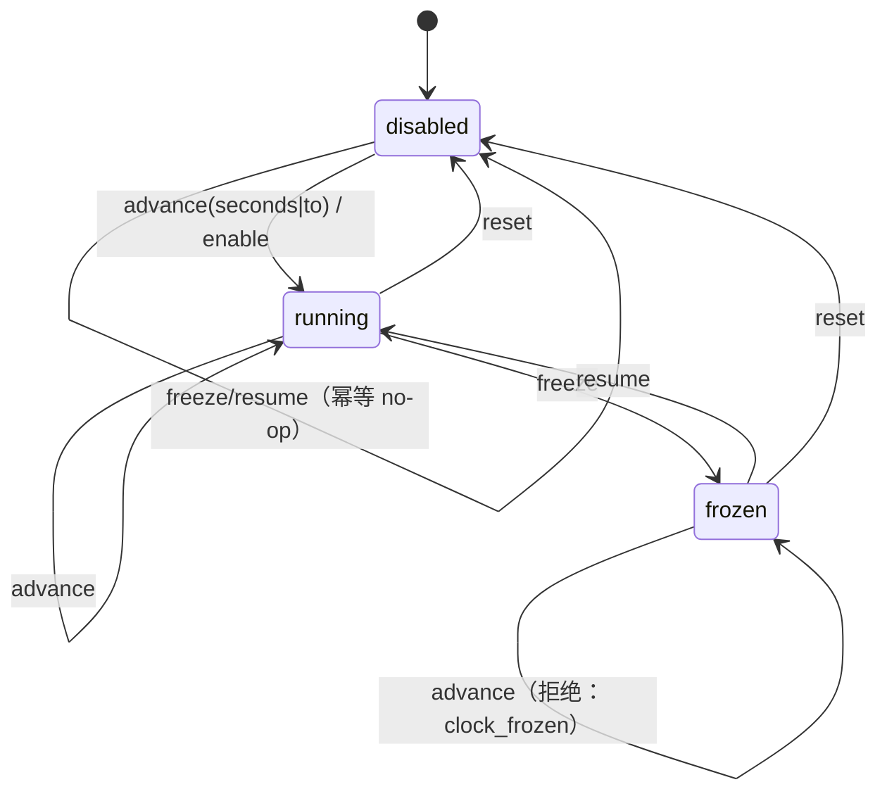

# AI Banking Agent 演示时钟设计说明

**版本**：v1.0  
**状态**：设计基线（对应实施计划 A1，代码由 B1/C1 落地）  
**适用项目**：`D:\Bank-Agent-legacy` / `Struct_of_Agent`  
**核心代码**：`Struct_of_Agent/common/clock.py`、`Struct_of_Agent/common/clock_store.py`、`Struct_of_Agent/web_test/api_clock.py`（均**需新增**）  
**配套文档**：`docs/演示时钟与人工介入-实施计划.md`（唯一权威工作契约）、`docs/ADR/ADR-003-演示时钟重启语义.md`、`docs/AI_Banking_Agent_人工介入中断设计说明.md`、`docs/AI_Banking_Agent_项目开发总架构文档.md`、`docs/AI_Banking_Agent_数据库设计文档.md`

本文说明「演示时钟」为什么需要、怎么实现、边界在哪里。文中表名、列名、API 路径、错误码与状态枚举以实施计划为准；与计划不一致之处一律汇总在 §11，不在正文里私自改契约。

## 1. 背景与需求追溯

演示现场没人愿意等一天，而 R1 定时转账、R5 续费提醒、R6 生日工作流全部以「到点」为触发条件。演示时钟把「到点」从自然时间解耦出来：可推进、可冻结、可复位，且**只影响业务触发判断**，不改变真实账务事实的时间戳语义。

| 需求/约束 | 原文位置 | 本设计如何满足 |
| --- | --- | --- |
| 「演示时钟」是 P0 交付能力 | `docs/AI_Banking_Agent_需求规格说明书.md:50` | 独立能力：`/api/clock/*` 五个接口 + 顶栏徽标 + 时钟面板；可单独路由、单独验收、单独停用（PRD `:119`） |
| 演示时钟只影响业务触发判断，审计同时记录真实记录时间和演示业务时间 | `docs/AI_Banking_Agent_项目开发总架构文档.md:119` | `Clock.now()` / `Clock.real_now()` 双时钟分离；`audit.clock_event` 与所有到期结算的 `audit.event` 同时写 `real_at` 与 `business_at`（§7.2） |
| 数据初始化、演示时钟和重置均需权限与审计；重置业务数据不得静默删除审计 | `docs/AI_Banking_Agent_项目开发总架构文档.md:126` | 写操作仅 `ops_admin`（`403 role_not_allowed`）+ `ack=true` 二次确认；每次变更双写审计；`reset` 只改时钟、不动业务数据与审计（§5.4、§7.1） |
| 管理员/运营演示角色「管理演示配置、重置数据…不能审批或代替用户执行金融写入」 | `docs/AI_Banking_Agent_需求规格说明书.md:74` | 时钟写操作收敛到 `ops_admin`；`risk_reviewer` 越权推时间 → `403 role_not_allowed` 并写审计（ADR-003 D8） |
| 定时转账「触发时重新检查余额、限额、账户、收款人和风险；不自动改期」 | `docs/AI_Banking_Agent_需求规格说明书.md:162` | `run_due` 只负责「找出到期任务」，命中后**重走最终安全门 + 易变事实重查**，不因时钟推进而跳过检查（§3.4） |
| 生日工作流「价格、库存和配送在最终确认前重查，变化时重新确认」 | `docs/AI_Banking_Agent_需求规格说明书.md:208` | 同上：推进触发不得复用旧报价/旧库存结论；事实变化则回到「待确认」而非直接下单 |
| 「时间必须带时区」 | `docs/AI_Banking_Agent_需求规格说明书.md:246` | 业务时间与真实时间均 tz-aware `Asia/Shanghai`；DB 列一律 `timestamptz`（§3.1、§4） |
| 审计须能关联用户/租户/任务/工具/风险决定/结果与时间；审计不可用时禁止写操作 | `docs/AI_Banking_Agent_需求规格说明书.md:236` | 审计同事务双写；`app.sim_clock` 不可读 → `503 clock_store_unavailable`，写操作 fail-closed（§5.6、ADR-003 D6） |
| 写操作确认前零执行、相同请求不重复副作用 | `docs/AI_Banking_Agent_需求规格说明书.md:265` | `advance` 必带 `ack=true`；到期结算按幂等键去重，同一次到期只结算一次（§3.4、§6.1） |
| 中断/恢复/重规划/可追踪性 | `docs/文档构建大纲.md:71` | 时钟推进是「可追踪」的时间锚点：每次推进落 `audit_id`，前端可回显本次触发摘要 |
| 两个待定 ADR（含「演示时钟重启语义」） | `docs/AI_Banking_Agent_项目开发总架构文档.md:216` | 由 `ADR-003` 记录：单行持久化 + 重启保持 + 一键重置 + 否决备选 |
| 「数据重置」为独立 P0 能力，不在本次范围 | `docs/演示时钟与人工介入-实施计划.md` §1.1、§5 | 见 §2 非目标；时钟 `reset` 与 `db/reset.py` 的 `reset_demo_data` 互不调用 |

## 2. 目标 / 非目标

### 2.1 目标

1. **单一业务时钟**：全系统取业务时间只有一个入口 `common.clock.get_clock()`；业务时间 = 真实时间 + 偏移（或冻结值）。
2. **推进即触发**：`POST /api/clock/advance` 之后立即结算到期任务（catch-up），不等下一次真实轮询。
3. **状态持久化**：`app.sim_clock` 单行；进程重启后位置保持（ADR-003）。
4. **可审计**：每次变更写 `audit.clock_event` + `audit.event`，同时保存 `real_at` / `business_at`。
5. **可演示**：前端顶栏业务时间徽标、时钟面板（+1h / +1d / 跳到指定时间 / 冻结 / 恢复 / 重置，每个操作二次确认）、对话流系统提示。
6. **可测试**：纯函数化的 `SimClock` 公式 + 可注入时钟 `use_clock()`，让「时间」在测试里成为参数而不是环境。

### 2.2 非目标（明确不做）

| 不做 | 原因 |
| --- | --- |
| **数据重置**（`reset_demo_data`） | 它是另一个 P0 能力，本次不在交付范围；时钟 `reset` 与它无调用关系 |
| 集群级时钟同步 / 分布式定时器 / 调度选举 | 演示环境单进程；多实例只共享同一行（ADR-003 D7） |
| 后台常驻定时线程 | 触发点显式化（推进 + 到期扫描接口），避免不可审计的并发源 |
| 按会话/按场景独立时钟 | 「全局唯一业务时钟」是需求定义；分叉会让审计失去可比性 |
| 「+1 个月」这类日历偏移 | 偏移以秒存储，只用 `+1h/+1d/跳到指定时刻`，避免月份长度歧义 |
| 业务时区可切换（多时区演示） | 首版固定 `Asia/Shanghai`（PRD `:246` 只要求「带时区」） |
| 多租户计费/配额 | 与演示时钟无关，属其它议题 |
| 用真实等待替代推进（sleep / 后台改库） | 前两者不可演示、不可审计 |

## 3. 领域模型与状态机

### 3.1 三个时间概念（不许混用）

| 概念 | 定义 | 来源 | 用途 |
| --- | --- | --- | --- |
| **真实时间** | 服务器墙钟，永远前进 | `Clock.real_now()`（内部 `datetime.now(ZoneInfo("Asia/Shanghai"))`） | 审计 `real_at`、日志、幂等记录 `created_at` |
| **业务时间** | 演示世界的时间 | `Clock.now()`，公式见 §3.2 | 到期判断、SLA 倒计时、定时任务触发、案卷 `business_at` |
| **偏移** | 业务时间 − 真实时间的秒数 | `app.sim_clock.offset_seconds` | 演示推进量；`+2h` 即 7200 |

补充约定：

- 两者都是 tz-aware，时区固定 `Asia/Shanghai`；数据库列统一 `TIMESTAMPTZ`（UTC 存储、按会话 `Asia/Shanghai` 渲染）。
- `enabled=false` 时 **`now()` 必须严格等于 `real_now()`**：实现里同一次调用只取一次真实时间，避免跨秒抖动导致断言不稳定。
- 「演示」字样必须出现在界面上（§7.4），不允许出现「用户以为这是真实时间」的界面。

### 3.2 Clock 协议与实现

`common/clock.py`（**需新增**）：

| 成员 | 签名 | 说明 |
| --- | --- | --- |
| `Clock` | 协议/抽象基类 | 只暴露 `now()` 与 `real_now()`，其余模块不关心实现 |
| `SystemClock` | `now() == real_now()` | `enabled=false` 的等价实现，也是默认实现 |
| `SimClock` | 组合 `clock_store` | 持有 `enabled`、`offset_seconds`、`frozen_at_business`、`version`；写入一律先落库再更新自身 |
| `get_clock()` | `-> Clock` | 进程级单例入口；首次调用由 `clock_store` 懒加载 |
| `use_clock(clock)` | 上下文/替换 | 测试注入替身；退出时恢复原实现 |
| `run_due(business_now)` | `-> list[dict]` | 到期结算入口，调用各领域注册的 due-scan 回调（§3.4） |

业务时间公式（与实施计划 §2.1 逐字一致）：

```
enabled = false                              -> now() = real_now()
enabled = true,  frozen_at_business is None  -> now() = real_now() + offset_seconds
enabled = true,  frozen_at_business is not None -> now() = frozen_at_business
```

「真实时间仍在走」必须写清楚（ADR-003 D4）：未冻结时两边**同速前进**，推进 `+2h` 相当于把演示世界整体平移两小时；冻结时业务时间停表而真实时间继续，因此审计里的 `real_at` 一直在前进、`business_at` 会停住。

### 3.3 状态机与迁移矩阵

三个状态：

| 状态 | 判定条件 | 界面徽标 |
| --- | --- | --- |
| `disabled`（真实时间） | `enabled=false` | `真实时间 2026-10-28 15:12` |
| `running`（演示滑动） | `enabled=true, frozen_at_business IS NULL` | `业务时间 2026-10-29 10:00 · 演示 +2h` |
| `frozen`（演示冻结） | `enabled=true, frozen_at_business IS NOT NULL` | `业务时间 2026-10-29 10:00 · 演示已冻结` |



合法迁移矩阵（服务层强校验；`rowcount=0` 或状态不符即拒绝）：

| # | from | 动作 | to | 前置条件 | 结果 |
| --- | --- | --- | --- | --- | --- |
| 1 | `disabled` | `advance` | `running` | `seconds>0` 或 `to>real_now()`；`ack=true`；`ops_admin` | `enabled=true`，`offset` 取自请求，`version+1`，立即结算 |
| 2 | `running` | `advance` | `running` | 同上 | `version+1`，立即结算 |
| 3 | `running` | `freeze` | `frozen` | `ack=true`；`ops_admin` | `frozen_at_business=now()`，`version+1` |
| 4 | `frozen` | `advance` | ✗ | —— | **`409 clock_frozen`**：冻结时推进等于隐式恢复，语义歧义 |
| 5 | `frozen` | `resume` | `running` | `ack=true`；`ops_admin` | 以 `frozen_at_business` 反算 `offset_seconds = frozen_at_business − real_now()`，清空冻结值，`version+1` |
| 6 | `frozen`/`running` | `reset` | `disabled` | `ack=true`；`ops_admin` | `enabled=false`、`offset=0`、`frozen=NULL`，`version+1` |
| 7 | `disabled` | `freeze` | `disabled`（no-op） | —— | 200，`message="已处于真实时间模式"`，不写领域事件（无变更） |
| 8 | `running` | `resume` | `running`（no-op） | —— | 200，幂等返回当前时钟 |
| 9 | 任意 | 并发写 | —— | `version` 不匹配 | **`409 clock_version_conflict`**，返回最新快照 |

非法迁移与报错码：

| 情形 | HTTP | `error_code` | 处理要求 |
| --- | --- | --- | --- |
| `disabled` 下 `advance` | 409 | `clock_disabled` | 提示先启用/推进（`advance` 本身即可启用，实现需支持从 `disabled` 直接推进） |
| `frozen` 下 `advance` | 409 | `clock_frozen` | 提示先 `resume` |
| `advance` 同时给 `seconds` 与 `to`，或都不给 | 400 | `clock_advance_invalid` | 二者必须恰好一个 |
| `advance` 目标早于当前业务时间（回退） | 400 | `clock_advance_backward` | 回退请用 `reset`，不做「倒带」 |
| 缺 `ack=true` | 400 | `ack_required` | 演示时钟是全局状态，必须二次确认 |
| `X-Role` 不是 `ops_admin` | 403 | `role_not_allowed` | fail-closed，写一条越权审计（§7.1） |
| `app.sim_clock` 不可读/不可写 | 503 | `clock_store_unavailable` | fail-closed，不回退真实时间（ADR-003 D6） |

### 3.4 到期结算（`run_due`）：推进 ≠ 放行

`common/clock.run_due(business_now)` 的职责**只有一件**：找出「业务时间已到期」的任务并交给各自领域处理。它不执行任何金融写入。

```
advance(seconds|to)
  ├─ 1. 条件更新 app.sim_clock（version+1）+ 写 audit.clock_event + audit.event   ← 同一事务
  ├─ 2. run_due(business_now)
  │     ├─ R1 due-scan：app.task 里 status='scheduled' AND scheduled_at <= business_now
  │     │                （可复用既有索引 ix_task_due，见 models.py 中 Task.__table_args__）
  │     ├─ R5 due-scan：到期续费提醒
  │     └─ R6 due-scan：生日工作流到点触发
  ├─ 3. 每个命中任务：重查易变事实（余额/限额/收款人/风险/库存/配送）→ 重走最终安全门
  │     → 幂等键 begin_operation(operation_type=工具名, key_value=任务级幂等键)
  │     → 执行 → complete_operation → 写 audit.event（含 real_at + business_at）
  └─ 4. 汇总 [{kind, id, summary}] 返回给前端做「本次触发了什么」提示
```

四条硬规则：

1. **触发不等于放行**：需求 `:162` 要求触发时重查余额/限额/账户/收款人/风险；需求 `:208` 要求价格库存配送在最终确认前重查。架构 `:119` 同样要求「触发时不重复确认但仍须最终安全门和事实复查」。因此 `run_due` 命中任务后必须走与用户直接发起时**同一条**安全门。
2. **一次到期只结算一次**：结算使用 `db/idempotency.py` 的幂等键，`operation_type` = 工具名，`key_value` 形如 `due:{task_public_id}:{scheduled_at_iso}`；重复推进、并发推进、重启后重放都不会产生第二次扣款。
3. **失败与未知不清零**：结算结果未知 → 先查原操作（`查询` 优先），仍无法确定 → 创建人工案件（`reason_code=unknown_result`，见 HITL 设计说明），任务状态不得写 `succeeded`。
4. **事实变化要回到确认**：重查发现收款人/金额/价格/库存变化 → 不执行，落「待确认」并提示用户重新确认（PRD `:210`「修改后相关确认失效」）。

回调注册：`common/clock.py` 提供 `register_due_scan(callback)`（**需新增**），R1/R5/R6 在装配时注册，签名固定 `(business_now) -> list[dict]`（实施计划 §2.1）。调度器未注册任何回调时 `run_due` 返回空列表，不报错——这样时钟能力可以先独立上线。

## 4. 数据模型

迁移文件：`migrations/versions/0004_demo_clock_and_hitl.py`（**需新增**）；ORM 类加在 `Struct_of_Agent/db/models.py`（B0 负责），命名沿用既有风格（`__tablename__` 单数 snake_case、`CheckConstraint(..., name="...")`、末尾 `{"comment": "中文注释"}`）。

### 4.1 `app.sim_clock`（单行）

| 列 | 类型 | 可空 | 默认 | 约束/说明 |
| --- | --- | --- | --- | --- |
| `id` | `SMALLINT` | 否 | —— | 主键 `pk_sim_clock`；`CHECK (id = 1)` → `ck_sim_clock_single_row`（单行表的物理保证） |
| `enabled` | `BOOLEAN` | 否 | `false` | 是否启用演示时钟 |
| `offset_seconds` | `INTEGER` | 否 | `0` | `CHECK (offset_seconds BETWEEN -31536000 AND 31536000)` → `ck_sim_clock_offset_range`（±365 天） |
| `frozen_at_business` | `TIMESTAMPTZ` | 是 | `NULL` | `CHECK (frozen_at_business IS NULL OR enabled)` → `ck_sim_clock_frozen_requires_enabled` |
| `version` | `INTEGER` | 否 | `1` | `CHECK (version >= 1)` → `ck_sim_clock_version_positive`；每次变更 +1，用于并发保护 |
| `updated_by` | `VARCHAR(64)` | 否 | `'system'` | 操作员名（`X-Operator`），追溯用 |
| `updated_at` | `TIMESTAMPTZ` | 否 | `now()` | 最后一次变更的真实时间 |
| `real_at` | `TIMESTAMPTZ` | 否 | `now()` | 最后一次变更时的真实时间（与 `updated_at` 同事务同值，单列保留以对齐实施计划 §2.3 清单与审计对比） |

- 索引：仅主键。单行表不需要额外索引。
- 审计字段：`updated_by` / `updated_at` / `real_at`。业务时间不入此表（业务时间是**算出来的**，不是存出来的），避免「存了业务时间又和 offset 打架」。
- 初始化：迁移里 `INSERT` 默认行（`enabled=false, offset_seconds=0, version=1, updated_by='system'`），并加 `CHECK` 保证 `id=1` 不能被插出第二行。

### 4.2 `audit.clock_event`（只追加）

| 列 | 类型 | 可空 | 约束/说明 |
| --- | --- | --- | --- |
| `id` | `BIGSERIAL` | 否 | 主键 `pk_clock_event` |
| `action` | `VARCHAR(16)` | 否 | `CHECK (action IN ('enable','disable','advance','freeze','resume','reset'))` → `ck_clock_event_action` |
| `before` | `JSONB` | 否 | 变更前快照（`enabled/offset_seconds/frozen_at_business/version`），默认 `'{}'::jsonb` |
| `after` | `JSONB` | 否 | 变更后快照；**额外写入 `role`、`business_now`、`triggered_count`**（见偏差建议 O-4） |
| `operator` | `VARCHAR(64)` | 否 | `X-Operator`，缺省 `system` |
| `real_at` | `TIMESTAMPTZ` | 否 | 真实时间 |
| `business_at` | `TIMESTAMPTZ` | 否 | 变更后的业务时间 |
| `note` | `TEXT` | 是 | 演示说明（如「推进到生日当天」） |

- 索引：`ix_clock_event_real_at (real_at DESC)`。
- schema：`audit`。只追加语义需在 0004 迁移里加与 `audit.event` 同款的触发器（拒绝 `UPDATE`/`DELETE`/`TRUNCATE`）——`audit.event` 已有该触发器（见 `AuditEvent` 类注释），`clock_event` 需新增。
- 不建外键到 `app.sim_clock`：审计比业务行活得更久（与 `audit.event` 同一原则）。

### 4.3 与既有表的边界

| 既有对象 | 关系 |
| --- | --- |
| `audit.event`（`db/audit.py: append_event(...)`） | 时钟变更**同时**写一条通用审计（`action` 见 §7.1），与 `clock_event` 同事务 |
| `app.task` | 到期任务仍住原表，不新增时钟相关列；到期判断用 `scheduled_at`（`ix_task_due` 已存在） |
| `app.idempotency_key` | 到期结算的幂等记录住原表，不新增表 |
| `app.hitl_case` | 结算结果未知时创建人工案件，见 HITL 设计说明 §4 |

## 5. 接口契约

统一响应包（沿用 `Struct_of_Agent/web_test/server.py` 现有约定）：`{"ok": bool, "message": str, "error_code": str|null, "data": any}`。下文只画 `data` 内部结构。

鉴权与职责分离（实施计划 §1.3、§3）：请求头 `X-Role: user|risk_reviewer|ops_admin`（缺省 `user`）+ `X-Operator: <名字>`。**`/api/clock/*` 的写操作仅 `ops_admin`**。

### 5.1 `GET /api/clock`

```json
GET /api/clock
200 {"ok": true, "message": "", "error_code": null, "data": {
      "enabled": true,
      "business_now": "2026-10-29T10:00:00+08:00",
      "real_now": "2026-10-28T15:12:00+08:00",
      "offset_seconds": 72480,
      "frozen": false,
      "version": 4
   }}
```

任意角色可读（徽标需要）。`enabled=false` 时 `business_now == real_now`、`frozen=false`。

### 5.2 `POST /api/clock/advance`

```json
POST /api/clock/advance
{"seconds": 3600, "ack": true, "operator": "ops-demo", "note": "推进到生日当天"}
200 {"ok": true, "message": "已推进 1 小时，触发 2 项到期任务", "error_code": null, "data": {
      "clock": {"enabled": true, "business_now": "2026-10-28T16:12:00+08:00",
                "real_now": "2026-10-28T15:12:00+08:00", "offset_seconds": 3600,
                "frozen": false, "version": 5},
      "triggered": [{"kind": "task", "id": "task_7f3a", "summary": "定时转账 100.00 元已执行"},
                    {"kind": "reminder", "id": "sub_2b1c", "summary": "会员续费提醒已发出"}],
      "audit_id": 10231
   }}
```

- `{seconds | to}` **恰好一个**：`seconds` 为正整数；`to` 为 ISO 8601（`+08:00` 或不带时区视为 `Asia/Shanghai`）。
- 从 `disabled` 直接推进 → 自动 `enabled=true`（迁移矩阵 #1）。
- `triggered` 只做摘要，不含敏感字段（§7.3）。

### 5.3 `POST /api/clock/freeze` / `POST /api/clock/resume`

```json
POST /api/clock/freeze
{"ack": true, "operator": "ops-demo"}
200 {"ok": true, "message": "演示时钟已冻结在 2026-10-29 10:00", "error_code": null,
     "data": {"clock": {"enabled": true, "business_now": "2026-10-29T10:00:00+08:00",
                        "real_now": "2026-10-28T15:12:30+08:00", "offset_seconds": 72450,
                        "frozen": true, "version": 6}}}

POST /api/clock/resume
{"ack": true, "operator": "ops-demo"}
200 {"ok": true, "message": "演示时钟已恢复", "error_code": null,
     "data": {"clock": {"enabled": true, "business_now": "2026-10-28T15:13:00+08:00",
                        "real_now": "2026-10-28T15:13:00+08:00", "offset_seconds": 0,
                        "frozen": false, "version": 7}}}
```

- `freeze` 已冻结 / `resume` 未冻结 → 200 幂等 no-op（迁移矩阵 #7/#8），不写领域事件。
- `resume` 后的 `offset_seconds` 按「冻结值 − 真实时间」反算（示例中冻结跨过了整点，恢复后偏移随之缩小）。

### 5.4 `POST /api/clock/reset`

```json
POST /api/clock/reset
{"ack": true, "operator": "ops-demo", "note": "演示结束复位"}
200 {"ok": true, "message": "演示时钟已重置为真实时间", "error_code": null,
     "data": {"clock": {"enabled": false, "business_now": "2026-10-28T15:14:00+08:00",
                        "real_now": "2026-10-28T15:14:00+08:00", "offset_seconds": 0,
                        "frozen": false, "version": 8}}}
```

只改时钟：**不删业务数据、不删审计**（架构 `:126`）。数据重置请走 `db/reset.py`（不在本次范围）。

### 5.5 错误码表

| `error_code` | HTTP | 触发条件 | 前端处理 |
| --- | --- | --- | --- |
| `ack_required` | 400 | 缺 `ack=true` | 弹出二次确认后重试 |
| `clock_advance_invalid` | 400 | `seconds` 与 `to` 同时给或都不给；`seconds<=0` | 面板输入校验 |
| `clock_advance_backward` | 400 | `to` 早于当前业务时间 | 提示「回退请用重置」 |
| `clock_disabled` | 409 | 需要 `enabled=true` 的操作在 `disabled` 下发起且无法隐式启用 | 提示先推进时间 |
| `clock_frozen` | 409 | 冻结状态下 `advance` | 提示先恢复 |
| `clock_version_conflict` | 409 | 并发变更撞 `version` | 自动 `GET /api/clock` 后重试一次 |
| `clock_store_unavailable` | 503 | `app.sim_clock` 不可读写 | 顶部红条 + 禁用时钟面板；写操作 fail-closed |
| `role_not_allowed` | 403 | `X-Role` 不是 `ops_admin` | 提示切换身份；后端写越权审计 |
| `operator_required` | 403 | 写操作缺 `X-Operator` | 要求填写操作员名 |

（这些错误码中 `clock_version_conflict` / `clock_advance_backward` / `clock_store_unavailable` / `operator_required` 是计划未穷举、本设计补齐的，见 §11 O-2。）

### 5.6 前端呈现（`Struct_of_Agent/web_test/index.html`，单文件）

| 位置 | 元素 | 细节 |
| --- | --- | --- |
| 顶栏 | 业务时间徽标 | `业务时间 2026-10-29 10:00 · 演示 +2h`；`enabled=false` 显示 `真实时间 2026-10-28 15:12`；冻结时追加 `· 已冻结` |
| 顶栏 | 时钟面板入口 | 点击展开：`+1h` / `+1d` / 跳到指定时间 / 冻结 / 恢复 / 重置 |
| 面板 | 二次确认 | 复用既有自绘确认框 `askConfirm(...)`（`index.html` 已有，删除会话流程在用；不依赖 `window.confirm`） |
| 对话流 | 系统提示 | 推进成功后插入一条系统消息「演示时间已推进至 …，触发 N 项到期任务」；前端本地渲染 + 可选携带 `session_id` 落库（见 §11 O-5） |
| 全局 | 演示声明 | 徽标内固定「演示」字样 + 面板顶部一行说明「演示时钟只影响业务触发判断，不改变真实账务事实」 |

前端所有请求复用既有 `callApi()` 与错误提示风格，不新增框架依赖（实施计划 §2.4）。

## 6. 关键流程时序

### 6.1 推进时间 → 结算到期任务

```
操作员            前端                   api_clock                clock_store           run_due → 领域
  │  点 +1h         │                        │                        │                    │
  ├───────────────►│ askConfirm 二次确认     │                        │                    │
  │                ├── POST /api/clock/advance {seconds:3600, ack:true, operator} ──────────►
  │                │                        ├─ 校验 X-Role=ops_admin ─► 403 role_not_allowed（+审计）
  │                │                        ├─ 读 sim_clock（version=4）◄────────────────────┤
  │                │                        ├─ 条件更新 ... WHERE version=4 ──────────────────►
  │                │                        │   （rowcount=0 → 409 clock_version_conflict）
  │                │                        ├─ audit.clock_event(before/after, real_at, business_at)
  │                │                        ├─ audit.event(action="clock.advance")  ← 同事务提交
  │                │                        ├─ run_due(business_now) ─────────────────────────►
  │                │                        │                        │  每个到期任务：重查事实 → 最终安全门
  │                │                        │                        │  → begin_operation(幂等) → 执行
  │                │                        │                        │  → complete_operation → audit.event
  │                │                        ◄── [{kind,id,summary}, ...] ──────────────────────┤
  │                │◄── 200 {clock, triggered, audit_id}             │                    │
  │                │ 刷新徽标 + 插入系统消息                          │                    │
```

### 6.2 冻结 / 恢复

```
freeze: ops_admin + ack → 条件更新(frozen_at_business=now(), version+1) → 审计双写 → 200 {clock}
        （已冻结 → 200 no-op）
resume: ops_admin + ack → offset_seconds = frozen_at_business − real_now()
        → frozen_at_business=NULL, version+1 → 审计双写 → 200 {clock}
        （未冻结 → 200 no-op；恢复后不自动 run_due，推进才是触发动作）
```

### 6.3 重置

```
reset: ops_admin + ack → enabled=false, offset=0, frozen=NULL, version+1
       → audit.clock_event(action='reset', before/after) + audit.event(action='clock.reset')
       → 200 {clock}；不动 app.* 业务表，不动 audit.* 任何历史行
```

### 6.4 服务重启

```
启动（uvicorn / 测试 live_server）
  → assert_schema_current（db/session.py，只校验迁移版本）
  → 首次 get_clock() → clock_store.load() 读 app.sim_clock
  → 命中行：恢复 enabled/offset/frozen/version（重启保持，ADR-003 D2）
  → 未命中行（迁移已执行但从未启用）：插入默认行
  → 读失败：ClockStoreUnavailable → /api/clock 返回 503 clock_store_unavailable
```

## 7. 审计与合规

### 7.1 双写：领域事件表 + `audit.event`

每次时钟变更在**同一事务**里写两处（`append_event` 只 `flush` 不 `commit`，见 `Struct_of_Agent/db/audit.py`）：

| 场景 | `audit.clock_event.action` | `audit.event.action` | `metadata` 关键字段 |
| --- | --- | --- | --- |
| 推进 | `advance` | `clock.advance` | `before/after`、`operator`、`role`、`business_at`、`triggered_count` |
| 冻结 | `freeze` | `clock.freeze` | 同上（`triggered_count=0`） |
| 恢复 | `resume` | `clock.resume` | 同上 |
| 重置 | `reset` | `clock.reset` | 同上 |
| 首次启用（隐式） | `enable` | `clock.enable` | 由 `advance` 触发时 action 记 `advance`，`after.enabled` 体现启用 |
| 越权尝试 | ——（无变更） | `clock.denied` | `operator`、`role`、`endpoint`、`error_code="role_not_allowed"` |

- `audit.event.resource_type="sim_clock"`，`resource_id=NULL`（该表主键为 `SMALLINT`，与 `resource_id UUID` 不兼容）；`request_id` 取请求头的追踪标识（若前端未传则为 `NULL`）。
- **审计不可静默删除**：`audit.clock_event` 加 append-only 触发器；`reset` 不清审计（架构 `:126`）。

### 7.2 `real_at` / `business_at` 双时间

| 落点 | `real_at` | `business_at` |
| --- | --- | --- |
| `audit.clock_event` | 变更瞬间真实时间 | 变更后业务时间 |
| `audit.event`（时钟类） | `created_at`（真实时间） | `metadata.business_at` |
| 到期结算的领域审计 | `created_at` | `metadata.business_at` |
| `app.sim_clock` | `real_at` / `updated_at` | 不存（算出来） |

两者关系可校验：`running` 态下 `business_at − real_at ≈ offset_seconds`；`frozen` 态下该差值随时间增大——这正是「冻结时真实时间仍在走」的可审计证据。

### 7.3 脱敏

- 时钟接口**不返回任何用户金融数据**：`triggered[].summary` 只给「对象 + 动作 + 金额区间或任务号」，例如 `定时转账 100.00 元已执行`，不得出现完整账号、卡号、手机号、身份证（需求 `:234`）。
- 前端徽标/面板只显示时间、偏移、操作员名。
- `audit.clock_event.note` 允许演示说明，但不允许写入完整账号等敏感串；面板输入框做长度与字符白名单校验。

### 7.4 P0「演示」声明如何在界面上呈现

| 要求 | 呈现 |
| --- | --- |
| 用户必须知道当前时间不是真实时间 | 顶栏徽标常显：`业务时间 … · 演示 +2h`；`enabled=false` 时显式显示 `真实时间 …` |
| 演示时钟是可控的、可复位的 | 面板顶部固定一行「演示时钟只影响业务触发判断，不改变真实账务事实；可随时重置为真实时间」 |
| 冻结不是卡死 | 冻结时徽标加 `· 已冻结` 并在面板显示「时间已暂停，SLA 倒计时停止」 |
| 不出现「假成功」 | 推进触发的任务若结果未知，卡片显示「结果未知，已转人工」，绝不显示成功（需求 `:250`） |

## 8. 测试计划

测试文件名与实施计划 §4（B1）一致：`tests/test_sim_clock*.py`、`tests/test_api_clock*.py`。前端静态契约归入 `tests/test_web_ui_clock_panel.py`（对齐既有 `tests/test_web_ui_delete_button.py` 的做法：读 `index.html` 断言关键实现存在；文件名不在计划清单内，见 §11 O-6）。PG 相关用例依赖 `BANK_AGENT_TEST_DB_URL`（`tests/conftest.py` 的 `runtime_pg_database` / `pg_clean` / `live_server` 夹具；未设置则 skip）。

### 8.1 单元（纯逻辑，不需要数据库）

| 文件 | 测试方法名建议 | 断言要点 |
| --- | --- | --- |
| `tests/test_sim_clock.py` | `test_system_clock_now_equals_real_now` | 固定 `real_now()` 后 `now() == real_now()`，精确到微秒 |
| | `test_sim_clock_disabled_ignores_offset` | `enabled=False, offset=7200` → `now()==real_now()` |
| | `test_sim_clock_running_adds_offset` | `enabled=True, offset=7200` → `now()-real_now()==7200s` |
| | `test_sim_clock_frozen_is_constant` | 冻结值固定；`real_now()` 前进 60 秒后 `now()` 不变 |
| | `test_sim_clock_now_is_asia_shanghai_tz` | `now().tzinfo` 显示 `+08:00` |
| | `test_use_clock_restores_previous_clock` | 注入替身后退出恢复，不污染其他用例 |

### 8.2 单元（持久化）

| 文件 | 测试方法名建议 | 断言要点 |
| --- | --- | --- |
| `tests/test_sim_clock_store.py` | `test_store_seeds_default_single_row` | 空库首次 `load()` 插入 1 行且 `id==1, enabled=false, version=1` |
| | `test_store_rejects_second_row` | 手工插入 `id=2` → `IntegrityError`（`ck_sim_clock_single_row`） |
| | `test_store_roundtrip_survives_new_instance` | 写入 `offset=7200` 后新建实例（模拟重启）读回同值 |
| | `test_store_version_increments_on_each_write` | 连续两次写入 `version` 递增；用旧 `version` 写入 → 冲突 |

### 8.3 接口（HTTP）

| 文件 | 测试方法名建议 | 断言要点 |
| --- | --- | --- |
| `tests/test_api_clock.py` | `test_get_clock_defaults_to_real_time` | `enabled=false`、`business_now==real_now`、`frozen=false` |
| | `test_advance_requires_ack` | 缺 `ack` → 400 `ack_required`，时钟未变 |
| | `test_advance_rejects_both_seconds_and_to` | → 400 `clock_advance_invalid` |
| | `test_advance_from_disabled_enables_clock` | `disabled` + `seconds=3600` → 200 且 `enabled=true, offset=3600` |
| | `test_freeze_then_advance_returns_clock_frozen` | → 409 `clock_frozen` |
| | `test_freeze_and_resume_are_idempotent` | 重复调用均 200、`version` 不增、领域事件不新增 |
| | `test_reset_restores_real_time_and_keeps_audit_rows` | `enabled=false,offset=0`；`audit.clock_event`/`audit.event` 行数不减 |
| | `test_clock_change_writes_dual_audit_with_both_timestamps` | 每条变更 1 行 `clock_event` + 1 行 `audit.event`，`real_at`/`business_at` 均非空 |
| `tests/test_api_clock_auth.py` | `test_clock_write_requires_ops_admin_role` | `X-Role=user/risk_reviewer` → 403 `role_not_allowed`，状态不变 |
| | `test_denied_clock_write_is_audited` | 越权后 `audit.event` 出现 `clock.denied` |
| | `test_clock_write_requires_operator_header` | 缺 `X-Operator` → 403 `operator_required` |

### 8.4 端到端（推进 → 结算）

| 文件 | 测试方法名建议 | 断言要点 |
| --- | --- | --- |
| `tests/test_sim_clock_due.py` | `test_advance_triggers_due_task_once` | 造一条 `scheduled_at` 在业务时间后的任务 → `advance` 越过它 → 任务被触发 1 次（`app.task.status` 变更 + 1 条结算审计） |
| | `test_repeated_advance_does_not_double_settle` | 再次 `advance` 相同区间 → 无新结算、账户余额不再变化（幂等键生效） |
| | `test_due_scan_runs_final_gate_and_refetches_facts` | 桩掉事实查询，返回余额不足 → 任务**不执行**且落 `failed`/人工案件，不得写 `succeeded` |
| | `test_frozen_clock_does_not_expire_cases` | 冻结后推进真实时间 → SLA/到期判定不推进（与 HITL 联动，见 HITL 设计说明 §8） |
| | `test_clock_state_survives_process_restart` | 重建 `SimClock`（模拟重启）后 `GET /api/clock` 的业务时间与重启前差值 < 1 秒 |

### 8.5 前端静态契约

| 文件 | 测试方法名建议 | 断言要点 |
| --- | --- | --- |
| `tests/test_web_ui_clock_panel.py` | `test_toolbar_shows_business_time_badge` | `index.html` 含 `业务时间`、`演示`、`真实时间` 三种文案分支 |
| | `test_clock_panel_requires_confirmation` | 面板按钮调用 `askConfirm(`，且全文不含 `window.confirm(` |
| | `test_clock_panel_calls_all_clock_endpoints` | 出现 `/api/clock/advance`、`/freeze`、`/resume`、`/reset` 四个路径 |
| | `test_clock_panel_renders_triggered_summary` | 响应处理里有 `triggered` 渲染与系统提示插入 |

## 9. 风险与未决项

| 编号 | 风险 / 未决 | 描述 | 处理 |
| --- | --- | --- | --- |
| R-1 | **Checkpointer 是否可用导致两条恢复实现路径** | 仓库现有图使用 `MemorySaver`（`common/agent.py`、`R1/graph.py`、`R2/graph.py` 均 `from langgraph.checkpoint.memory import MemorySaver`），进程内、不持久、未使用 `interrupt()/Command(resume=)`。因此「推进触发 → 中断 → 恢复」有两条路：(a) 若接入持久化 checkpointer 且 `graph_thread_id` 可用 → 用 LangGraph `interrupt()/Command(resume=)`；(b) 否则「proposal 存档 + 重放」，由 `common/hitl.py` 重新走安全门执行。本设计**只依赖 (b)**，(a) 标为未决升级项；两条路都必须保留 `graph_thread_id` 字段（实施计划 §2.2）。 | 时钟侧不受影响（`run_due` 只产生摘要）；HITL 侧默认走 (b)，见 HITL 设计说明 §9 R-1 |
| R-2 | **业务代码直接 `datetime.now()` 绕过时钟** | 全仓若存在直接取当前时间的业务判断，时钟推进就会「一半生效」：任务到期由时钟算，而别处仍用真实时间，导致前后矛盾。 | B1 落地时用 `grep -n "datetime.now(\|utcnow("` 建立清单：`db/base.py:utcnow()` 与 `TimestampMixin` 属**真实时间**语义（允许）；凡用于业务到期/有效期判断的一律改为 `get_clock().now()`；新增一条单测/静态检查断言 `common/clock.py` 之外无业务时间取值（可放宽为白名单机制） |
| R-3 | 并发推进导致重复结算 | 两个请求同时 `advance` 到同一区间 | `app.sim_clock.version` 条件更新 + 结算幂等键双保险；先到者成功，后到者 409 `clock_version_conflict` |
| R-4 | 一次性「追回」大量到期任务 | 推进 `+30d` 时数百条任务同时到期 | `run_due` 分批（每批上限可配），前端只显示摘要计数；单条失败不影响其余（逐条事务） |
| R-5 | 时钟全局性污染测试 | 一个用例把时钟推到 `+1d`，后续用例看到不同业务时间 | `pg_clean` 重建库；每个时钟用例结束显式 `reset`；测试默认 `use_clock(SystemClock())` |
| R-6 | 审计不可用时的可用性代价 | 审计写失败 → 整笔时钟变更回滚 → 演示卡住 | 这是设计意图（fail-closed，架构 `:199`）；面板给出 `clock_store_unavailable` 明确提示，不静默降级 |
| R-7 | 前端倒计时与服务器时间偏差 | 浏览器与服务器时钟不一致 | 倒计时以服务端返回的 `business_now` 为基准做本地递减，每次接口响应重新对齐；判定权始终在服务端 |
| U-1 | 推进是否需要落对话系统消息 | 实施计划 §1.1 第 5 条提到「对话流插入系统提示」，但 §3 契约无 `session_id` 参数 | 首版前端本地插入；若需落库，`advance` 增加可选 `session_id`（见 §11 O-5） |
| U-2 | `advance` 的 `enable` 语义 | 从 `disabled` 推进是否算一次 `enable` 事件 | 首版：`clock_event.action='advance'`，`after.enabled=true`；不额外写 `enable` 行（避免一次操作两条事件） |

## 10. 验收清单

- [ ] `GET /api/clock` 在默认库返回 `enabled=false`，且 `business_now == real_now`。
- [ ] `POST /api/clock/advance {seconds:3600, ack:true}`（`ops_admin`）→ 200，`offset_seconds` 增加 3600，`version` 递增。
- [ ] 推进越过某条 `app.task.scheduled_at` → 该任务被触发**一次**；再次推进同区间不重复扣款。
- [ ] 每次时钟变更产生 1 条 `audit.clock_event` + 1 条 `audit.event`，两者都含 `real_at`/`business_at`（或 `metadata.business_at`）。
- [ ] 进程重启（重建 `SimClock`）后 `offset_seconds`/`frozen_at_business`/`version` 与重启前一致（ADR-003）。
- [ ] `freeze` 后 `business_now` 保持不变而 `real_now` 继续前进；`resume` 后恢复滑动。
- [ ] 冻结状态下 `advance` → 409 `clock_frozen`；`disabled` 语义下非法参数 → 400 `clock_advance_invalid`/`clock_advance_backward`。
- [ ] 缺 `ack` → 400 `ack_required`；`X-Role=user|risk_reviewer` 写时钟 → 403 `role_not_allowed` 且落越权审计。
- [ ] `reset` 后时钟回真实时间，且 `audit.*` 行数不减、`app.*` 业务数据不受影响。
- [ ] 前端顶栏能显示 `真实时间` / `业务时间 … · 演示 +2h` / `… · 已冻结` 三态，面板六个操作均经 `askConfirm` 二次确认。
- [ ] 推进触发的任务若结果未知，界面显示「结果未知，已转人工」，不显示成功（需求 `:250`）。
- [ ] `tests/test_sim_clock*.py`、`tests/test_api_clock*.py`、`tests/test_web_ui_clock_panel.py` 全绿；`pytest tests -q` 不低于基线。

## 11. 对实施计划的偏差建议

> 正文严格按计划落地；以下是本设计发现的问题，**没有自行改契约**，提交主代理裁决。

| 编号 | 计划位置 | 问题 | 建议 |
| --- | --- | --- | --- |
| O-1 | §2.3 `app.sim_clock.id`(pk, 恒 1) | 与 `docs/AI_Banking_Agent_数据库设计文档.md` L43-59「主键 UUID」不一致（本表用 `SMALLINT` 恒 1） | 保留恒 1 的方案（单行表用 UUID 无意义），在数据库设计文档里注明「单例配置表例外」 |
| O-2 | §3 接口契约 | 只给了成功路径，未穷举错误码；`clock_version_conflict`、`clock_advance_backward`、`clock_store_unavailable`、`operator_required`、`role_not_allowed`、`ack_required`、`clock_frozen`、`clock_advance_invalid` 均无定义 | 采纳本文 §5.5 的错误码表，回填到计划 §3 或保持「以设计说明为准」的表述 |
| O-3 | §3 `GET /api/clock -> {enabled, business_now, ...}` | 未说明这些字段位于统一响应包的 `data` 内还是与 `ok/message` 平级 | 明确为 `data` 内（本文按此实现）；否则前后端会对不上 |
| O-4 | §2.3 `audit.clock_event` 列清单 | 缺 `tenant_id` 与 `role`。需求 `:236` 要求审计能关联用户/租户；`X-Role` 是本次新增的鉴权维度，若不入审计，越权追溯只能靠 `operator` 猜 | 建议补 `tenant_id UUID NOT NULL` 与 `role VARCHAR(16)` 两列；若坚持不动表结构，则最少把 `role` 写入 `after` JSONB（本文当前按此兼容） |
| O-5 | §1.1 第 5 条「对话流插入系统提示」 vs §3 契约 `POST /api/clock/advance {seconds\|to, ack, operator?}` | 契约没有 `session_id`，后端无法知道要往哪个会话插系统消息 | 二选一：前端本地插入（本文首版）；或给 `advance` 增加可选 `session_id` 并落 `app.conversation_message` |
| O-6 | §4 任务拆分 | 未列与时钟相关的前端/端到端测试文件名；而 §5 验收要求「前端可见」 | 建议正式登记 `tests/test_sim_clock_due.py`、`tests/test_web_ui_clock_panel.py` |
| O-7 | §5 测试基线 | 基线写作「532 passed / 2 failed」，但同时说明设了 `BANK_AGENT_TEST_DB_URL` 时是 `3 failed, 689 passed, 1 skipped` | 建议把两条基线都列为门禁（带 PG 变量的全量基线才是真门禁），避免「不设变量跑绿」被当作通过 |

**修订记录**

| 版本 | 日期 | 说明 |
| --- | --- | --- |
| v1.0 | 2026-10-28 | 首版：三态时钟 + `run_due` 结算 + 双审计 + 职责分离 + 9 节完整设计，附 7 条偏差建议 |
