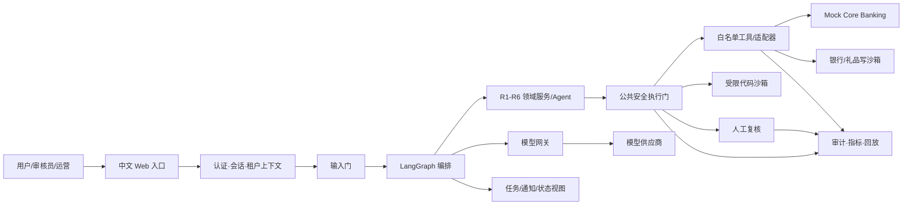
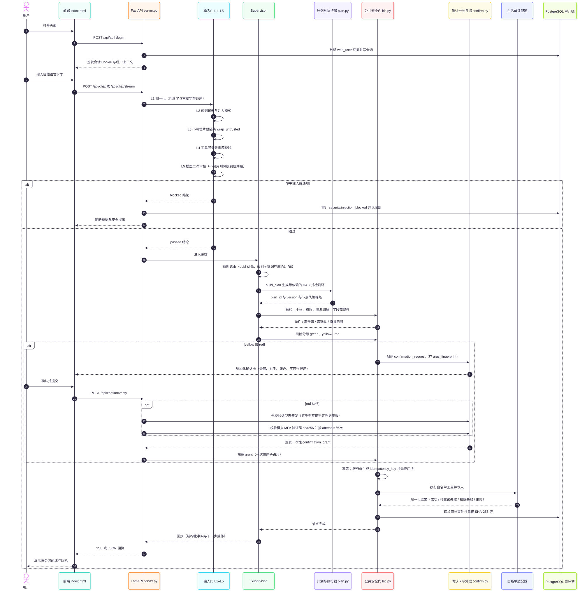

# AI Banking Agent 项目开发总架构文档

> 文档编号：DOC-ARCH-001  
> 版本：v2.0  
> 状态：开发架构基线  
> 适用：首版中文 Web 演示应用、六场景 P0、Vibe Coding 开发、测试与演示

## 0. 复用规则与来源优先级

本文只冻结架构边界、依赖方向、安全控制、开发顺序和验收门禁。字段、API/工具 Schema、表结构、完整状态机、Prompt、模型参数、测试用例和部署命令分别由 DOC-CONTRACT、DOC-DB、DOC-AGENT、DOC-TEST 及部署/README 承接。

内容按以下标签理解：**[比赛硬指标]**、**[PRD不可妥协]**、**[PRD其他P0]**、**[项目扩展P0]**、**[架构建议]**、**[待确认]**。冲突顺序固定为：比赛硬指标 > PRD 不可妥协基线 > PRD 其他 P0（含项目扩展 P0） > P1/P2 > 架构建议。架构建议经 ADR 接受后才能冻结；待确认事项不得成为隐含实现前置。

涉及范围、权限、确认、审计、真实/沙箱边界或验收口径的变更，必须先修订 PRD，再同步本文和受影响的契约、设计、测试、部署与演示资料。

## 1. 首版边界与总体目标

首版是可从 GitHub 获取并本地启动的中文文本 Web 应用，使用 CNY、Asia/Shanghai、一个专用演示租户、合成数据、Mock Core Banking 和银行/礼品写沙箱。禁止真实资金、真实客户数据、真实第三方下单、真实 KYC/AML、真实密码/PIN 修改。模型只能理解、规划和解释，不能成为银行账务、适当性或风控最终决定。

用户输入经“识别—澄清—计划—预检—确认—执行—回执”闭环完成任务。页面和对话必须支持低轮次追问、上下文引用、取消、恢复、失败重试引导、人工接管、超范围兜底和清晰的处理中/未知状态；通过任务时间线、结构化确认卡、事实依据和下一步操作降低认知负担，支持可感知的交互创新与错误恢复；不能把固定脚本或模型文本当作业务事实。

## 2. P0 能力承接

六场景及下列子能力均为 **[PRD其他P0]**，每项须独立路由、独立停用、独立验收和可重复演示；六场景覆盖本身属于 **[比赛硬指标]**。

| 领域 | P0 子能力 | 架构承接 |
|---|---|---|
| R1 智能转账 | 姓名、手机号、历史备注转账；定时转账；拆分 AA 收款 | 转账领域服务 + 统一安全门 + Mock Core Banking；AA 仅站内请求，参与人只见本人份额 |
| R2 账单分析 | 消费分类、异常交易、月度报告、年度报告 | 账单领域服务；只用已入账流水，分类合计可与事实对账 |
| R3 理财操作 | 风险评估、产品推荐/对比、一键申购、一键赎回 | 理财领域服务；适当性和事实由服务端校验，写入仅到沙箱 |
| R4 卡片管理 | 虚拟/演示卡申请、额度调整、交易限制/解锁、挂失/冻结 | 卡领域服务；状态变更经过确认、风控和回执校验 |
| R5 订阅/代扣 | 自动识别订阅扣费、续费提醒、一键取消订阅/代扣 | 订阅领域服务；区分银行撤权和商户解约，均不得伪造结果 |
| R6 跨场景联动 | 生日预算预留、定时触发、鲜花和蛋糕礼品沙箱订单 | 跨场景编排只协调依赖；预算、订单、最终确认和逐项结果分别可追踪 |

绿色/黄色/红色是 **[比赛硬指标]+[PRD不可妥协]** 的统一风险基线：绿色为授权后的纯查询/分析/草稿自动完成；黄色至少包括小额转账、虚拟/演示卡申请、预算预留、交易限制设置以及订阅查询/提醒管理，必须展示完整事实并取得明确确认；红色至少包括日累计超过 1,000 元的转账、理财申购/赎回、额度调整、卡片解锁/挂失、银行代扣授权撤销和礼品下单，必须确认、模拟 MFA，并按策略进入人工复核。订阅/代扣取消必须按银行授权撤销与商户解约分别定级，前者至少红色；日累计转账不得通过拆单规避；密码修改不在本版本范围，也不得注册工具。

## 3. 总体架构、模块边界与依赖方向

> 图 FIG-01 系统上下文：用户、演示身份、审核员与运营经中文 Web 入口进入，Agent 只通过白名单适配器访问 Mock Core Banking 与银行/礼品写沙箱。
> 模型调用统一走本地模型网关（8010），网关之外没有任何真实模型供应商、真实核心系统或真实第三方下单通道。
> 图中所有外部边界标注「禁止真实出站」：无真实资金、无真实客户数据、无真实 KYC/AML、无真实第三方下单。
> 因此该图就是演示链路的完整信任边界，任何新增出站目标都必须先改 ADR 与安全设计文档。

| 模块 | 必须负责 | 不得负责 |
|---|---|---|
| Web/认证会话 | 中文交互、角色、会话、租户和资源所有者上下文、状态呈现 | 前端判权、直连数据库/工具、持有银行凭据 |
| 输入门 | 身份/租户/资源校验、字段完整性与歧义检查、提示注入和敏感输入拦截 | 放行未澄清的关键字段；被模型结果覆盖 |
| LangGraph 编排 | 路由、澄清、计划依赖、暂停/恢复、重规划、轨迹 | 直接写银行、批准风险、绕过安全门 |
| R1-R6 领域服务/Agent | 本领域规则、结构化业务对象、事实查询和领域验收 | 跨域私取数据、动态注册工具、直接写适配器 |
| 公共安全执行门 | 权限、风险、确认、模拟 MFA、人工复核、幂等、写前复查、审计 | 被 UI、Agent、工具或配置旁路 |
| 工具/适配器 | 固定白名单、参数与资源校验、沙箱调用、结果规范化 | 接受模型任意函数名、目标地址或自然语言金融命令 |
| Mock Core Banking | 合成余额、流水、产品、卡、授权、预算及操作查询事实 | 接入真实核心或允许外部模型直接写入 |
| 银行/礼品写沙箱 | 模拟金融/礼品副作用并给出可核验回执 | 真实资金移动、真实客户数据、真实第三方下单 |
| 模型网关 | 最小上下文、脱敏、结构校验、供应商隔离/替换、用量统计 | 授权、保存凭据、修改审计或事实 |
| 代码沙箱 | 受限计算、无网络/无凭据/资源限制、输出校验 | 访问金融工具、宿主、秘密或把输出当权威事实 |
| 人工复核 | 单案件单审核员的通过/拒绝/补件及理由 | 代替用户确认、查看无关资源、审批本人案件 |
| 审计/可观测性 | 审计、运行日志、指标、告警、轨迹/回放及脱敏运营视图 | 静默删除、以日志替代事实或审计 |

> 图 FIG-02 容器分层：请求自前端（`web_test/index.html`，当前由 API 进程在 8000 直出）进入 FastAPI，交 Supervisor 意图路由到 R1–R6 领域 Agent。
> 领域 Agent 只能经公共安全门（输入门 → 工具门 → 输出门）调用白名单适配器，再由适配器写入 Mock Core Banking 或银行/礼品写沙箱。
> 审计、指标与受限代码沙箱（8022）旁挂在安全门两侧：审计不可用即拒绝写路径，代码沙箱无网络、无凭据、无金融写权限。
> 依赖方向因此单向收敛为 入口 → 编排 → 领域 → 安全门 → 适配器 → 事实源/沙箱，禁止 UI→DB 与 Agent→写接口的直连。

依赖方向固定为：入口 → 应用/编排 → 领域服务 → 公共安全门 → 白名单适配器 → 沙箱/事实源。禁止 UI→DB、Agent→银行写端、领域循环依赖和安全门旁路。

代码沙箱调用也必须经过白名单工具和执行策略检查；代码沙箱不授予金融写权限。若其输出进入任何金融、授权、卡、预算或礼品写流程，必须重新经过完整工具门、确认、风险控制、幂等和审计路径。

## 3.1 技术栈与决策状态

| 领域 | 基线 | 状态与边界 |
|---|---|---|
| 交付入口 | 本地中文文本 Web | **[PRD不可妥协]**；APP/外部 IM 不作为首版前置 |
| 任务编排 | LangGraph + 持久化 checkpoint | **[PRD冻结]**；必须支持暂停、恢复、观察和重规划 |
| 前端 | React + TypeScript + Vite | **[架构建议/待确认]**；可替换，但必须保留统一会话、确认卡、状态时间线和任务查询能力 |
| 后端 | Python + FastAPI | **[架构建议/待确认]**；可替换，但不得改变安全门和领域端口边界 |
| 持久化 | PostgreSQL | **[架构建议/待确认]**；用于事务、并发、任务/审计关联；替换时必须保持幂等、恢复和租户约束 |
| 模型接入 | 统一模型网关 | **[PRD/架构边界]**；供应商、区域、数据条款待确认，模型无凭据和授权能力 |
| 金融事实 | Mock Core Banking | **[PRD不可妥协]**；是余额、流水、产品、卡、订单和操作查询的事实边界 |
| 写入环境 | 银行/礼品写沙箱 | **[PRD不可妥协]**；仅白名单适配器可访问，不产生真实副作用 |
| 受限计算 | 独立代码沙箱 | **[比赛硬指标]+[PRD]**；运行时待确认，无网络、无凭据、资源受限和输出校验不可降低 |

在 React/FastAPI/PostgreSQL 或代码沙箱运行时未完成 ADR 前，开发可以使用等价替代，但不得把建议栈写成需求，也不得先实现依赖未确认的外部集成。

## 4. 输入门、工具门、输出门与权限约束

三道门是每次请求的强制路径；任一道不可用，写操作必须 fail-closed。

| 门 | 通过条件 | 失败处理 |
|---|---|---|
| 输入门 | 会话有效、租户/所有者匹配、关键字段明确、输入未触发注入/越权规则 | 澄清、拒绝或暂停并审计 |
| 工具门 | 工具在白名单、参数/金额/资源合法、风险级别确定、确认/MFA/人工条件满足、幂等键与审计可用、写前事实新鲜 | 不调用写工具；转待确认、失败、人工或未知 |
| 输出门 | 结果来自沙箱/事实源，状态、金额、对象、部分完成和下一步均与回执一致，敏感字段已脱敏 | 重新查询、补偿或人工；禁止包装成成功 |

确认必须绑定对象、金额/范围、账户或卡尾号、时间、费用/风险和预计结果。任何资金、授权、卡状态、预算预留、礼品/金融订单或可复用自动化任务写入，都必须先取得明确确认；金额、收款人、账户、地址、商品、时间或风险事实变化时旧确认失效。普通“好的”不构成高风险确认；模拟 MFA 仅表示演示控制，不得表述为真实身份认证。

每次请求至少形成结构化的领域/动作、已识别实体、缺失或歧义字段、用户约束、计划摘要、风险/确认建议、事实引用和任务追踪标识。结构化校验失败时不得调用写工具，应澄清、暂停或失败并审计。

所有写操作服务端生成幂等控制和任务追踪标识；超时、断连或未知结果先查询原操作，禁止盲目重放。失败、处理中、部分完成、已取消、过期、结果未知和人工处理必须分别呈现；无法安全自动恢复时人工接管。

> 图 FIG-03 主链路时序：识别—澄清—计划—预检—确认—执行—回执，每次请求都必须依次穿过输入门、工具门、输出门。
> 黄色操作以结构化确认卡绑定对象、金额、账户或卡尾号、时间、费用与预计结果；红色操作追加模拟 MFA 与人工策略。
> 结果未知时先查询原操作再决定，禁止盲目重放；写前写后各落一条不可篡改审计事件，审计不可用则写路径 fail-closed。

## 5. LangGraph、任务恢复与业务事实一致性

LangGraph 是 **[PRD冻结约束]**，用于可暂停、可恢复、可观察和可重规划。checkpoint 只保存编排状态，不等于账务事实；每次恢复、定时触发和跨场景最终提交前，必须从 Mock Core Banking/沙箱重查易变事实并重新通过安全门。

跨步骤任务以业务任务记录、checkpoint 和沙箱操作记录三者关联；不得假设跨沙箱分布式事务。每个子操作独立记录状态，按权威回执汇总整体结果。AA 部分付款、生日订单部分完成、退款/冲正、预算释放失败和补偿失败均须可见，并可查询、补偿或转人工。演示预算只是余额占用，不是对外支付。

定时任务是可复用授权：创建、修改、暂停、取消需确认；触发时不重复确认但仍须最终安全门和事实复查。演示时钟只影响业务触发判断，审计同时记录真实记录时间和演示业务时间。任务取消不等于副作用已取消，必须以沙箱事实核清。

> 图 FIG-06 DAG 执行与补偿：跨场景任务先编译成有依赖的 DAG，按拓扑序执行，每个子操作独立记录状态与权威回执。
> 预算变化或用户改口触发 replan：只重算受影响子图，已完成的子操作不重复执行、不重复产生副作用。
> 下游失败或取消时按逆序执行补偿；补偿失败、部分完成与结果未知都必须可见，可查询、可转人工或按沙箱事实核清。

## 6. 数据、租户、沙箱与运行边界

- 仅使用合成或批准脱敏数据；会话、任务、工具调用、对象和审计事件绑定演示租户与资源所有者，服务端每次访问重验。
- AA 参与人仅见本人份额；礼品地址、人工案件和运营视图按最小必要范围开放；账号、手机号、卡号、地址、OTP、生物信息不进入模型、日志、截图或导出，除非下游设计明确保护措施。
- 代码沙箱与金融/礼品写沙箱必须物理或逻辑隔离。代码沙箱无网络、无凭据、无宿主访问并受 CPU/内存/时长/输出限制；金融写沙箱只接收白名单适配器调用。
- 本地开发、自动测试、演示三套配置隔离；秘密运行时注入，不提交仓库，不进入模型和日志。数据初始化、演示时钟和重置均需权限与审计；重置业务数据不得静默删除审计。

模型、Mock Core Banking、银行/礼品沙箱、站内通知均通过适配器接入。仅在模型不可用且所需事实源仍可用时，意图识别或部分只读交互可降级为确定性规则/模板；Mock Core Banking、银行/礼品沙箱或审计不可用时，不得编造事实或成功，相关写操作暂停、转人工或展示结果未知。超出 P0 范围的请求应说明当前边界、提供可用的查询/方案预览或引导人工，不得隐式扩展工具。P1 的 IM、RAG、OCR，P2 的真实第三方适配器、多模型路由和本地离线推理不得成为 P0 前置。

> 图 FIG-04 数据模型 ER：`app` schema 承载业务任务、会话、确认凭据与幂等记录，`audit` schema 承载 append-only 审计事件。
> 业务任务、LangGraph checkpoint 与沙箱操作记录以任务标识关联，checkpoint 只保存编排状态、不被当作账务事实。
> 审计事件由数据库触发器强制 append-only（删除或改写即被拒绝）；逐条事件的 SHA-256 前序摘要链尚未落地，已在安全设计 §6.2 与安全自评 R-14 登记为残余风险。所有对象绑定演示租户与资源所有者，每次访问按当前主体重验。

## 7. 契约索引与下游文档边界

| 契约/文档 | 本文只规定 | 下游承接 |
|---|---|---|
| DOC-CONTRACT | 模块端口、结构化对象、状态语义、错误与幂等标识的边界 | 字段、API、工具 Schema、事件格式 |
| DOC-DB | 事实源、业务任务、checkpoint、审计与租户隔离原则 | 表结构、约束、索引、迁移、种子、重置 |
| DOC-AGENT | Agent 输入输出、图节点职责、恢复和模型网关边界 | 图拓扑、Prompt、模型参数、重规划算法 |
| DOC-TEST | 每个 P0 的成功/阻断/恢复证据和质量门 | 用例、夹具、评测集、红队、故障注入、压测 |
| 部署/README | 本地可运行、配置、依赖和回滚边界 | 命令、端口、环境变量、容器、备份恢复 |
| 演示资料 | 仅使用已验收 P0 的事实和状态 | 答辩稿、视频脚本、截图和操作顺序 |

## 8. 分阶段开发顺序与完成定义（DoD）

阶段必须按依赖顺序推进；后阶段不得用 Mock 绕过前阶段安全约束。

| 阶段 | 交付重点 | 完成定义（DoD） |
|---|---|---|
| S0 基线与脚手架 | 仓库、配置、依赖、追踪 ID、数据和秘密边界 | 本地三套配置可区分；无真实数据/秘密；CI 基础检查可运行 |
| S1 事实与契约 | Mock Core、银行/礼品沙箱、任务/审计模型、契约 | 事实查询、写回执、操作查询、重置和审计可复现；契约评审通过 |
| S2 安全执行骨架 | 认证、租户、三道门、权限、确认、MFA、幂等 | 绿/黄/红和 fail-closed 可测试；安全门无旁路；未知结果先查 |
| S3 LangGraph 与公共交互 | 路由、澄清、计划、checkpoint、恢复、状态视图 | 中断/恢复/重规划不重复副作用；状态与事实一致；追问可推动任务 |
| S4 六场景实现 | 按 R1→R6 接入领域能力 | 每项 P0 可独立路由/停用，成功、阻断、部分完成、人工和回放证据齐全 |
| S5 安全与质量验证 | 红队、故障注入、评测、性能、成本和可观测性 | 注入/越权/篡改/重复提交被阻断；指标、告警、成本上限和恢复结果可查 |
| S6 演示与交付 | 重置、演示脚本、README、作品资料 | 干净环境可复现；演示只使用已验收能力；追踪矩阵闭环 |

## 9. AI 编码助手操作规则

1. 编码前读取本文及关联 PRD 条目、契约和当前阶段 DoD；任务必须绑定 R1-R6 子能力或正式 FR ID，不得凭空创建需求编号。
2. 先声明改动层、依赖方向、风险级别和验收证据；不确定字段、规则、供应商、阈值或状态时标记“待确认”，不得猜测。
3. 任何写路径必须从公共安全门进入；助手不得生成 Agent 直连银行写接口、动态工具注册、自然语言转 SQL/Shell、绕过确认/MFA/审计的代码。
4. 优先复用已有契约、事实源、幂等键、审计和脱敏组件；不得为单场景复制一套安全门或以 UI 校验替代服务端校验。
5. 每次提交同时更新追踪 ID、测试/评测证据和必要的演示数据；变更范围、权限、真实/沙箱边界或验收口径时停止编码并要求 PRD/ADR 变更。
6. 生成或修改模型调用时，默认最小上下文、结构化输出、超时和成本上限；模型输出必须经过模式、业务事实和安全门校验。

## 10. 禁止实现清单

- 禁止真实资金、真实客户数据、真实第三方下单或生产凭据进入首版。
- 禁止模型直接访问银行/礼品写接口、决定权限等级、生成确认、执行 MFA、修改审计或自行增加工具。
- 禁止把余额、流水、产品、卡、订单或执行结果从模型记忆、缓存文本或 UI 状态推断出来。
- 禁止关键字段缺失时猜金额、收款人、账户、时间、地址、商品或风险属性。
- 禁止重复提交产生第二次副作用；未知结果禁止盲重放；禁止把处理中/部分完成/人工处理显示为成功。
- 禁止以拆单规避日累计限额、以人工批准替代用户确认、以前端过滤替代服务端租户隔离。
- 禁止代码沙箱访问网络、凭据、宿主或金融工具；禁止把代码输出当作金融事实。
- 禁止将 P1/P2 作为 P0 前置，禁止为了完整堆叠未确认能力或把架构建议写成需求。

## 11. 观测、测试、评测与 CI 门禁

所有请求、任务、图运行、工具调用、权限/风险决定、确认、MFA、人工案件、沙箱回执、补偿和状态变化共享追踪标识。审计不可静默删除；运行日志脱敏；LangGraph 轨迹可回放；运营视图按角色最小可见。

至少提供以下指标和告警：任务完成/阻断/人工/未知率，确认与澄清轮次，工具成功/拒绝/重复提交率，沙箱/审计/模型可用性，结果未知积压，对账差异，熔断状态，模型 token/调用成本，代码沙箱资源使用。写能力熔断、审计不可用、未知结果积压、人工案件和对账异常必须告警。

> 图 FIG-05 熔断状态机：closed → open → half_open 三态迁移，按写能力维度独立计数，读路径不受影响。
> 注入命中、越权、审计不可用等零容忍事件直接进入 open，不等待失败阈值累积。
> 连续失败达阈值后进入 open 并锁定写能力，运维复位后经 half_open 试探放行；当前状态由 `/health/circuit-breaker` 暴露。

DOC-TEST 必须承接：

- 六场景每个 P0 的成功、缺字段/歧义、越权、提示注入、风险升级、确认失效、失败、未知、部分完成、补偿和人工接管；
- 幂等并发、余额竞争、定时重启/时区、租户横向访问、脱敏、审计完整性和数据重置；
- 代码沙箱逃逸、网络/凭据访问、工具白名单、红队攻击和故障注入；
- 任务完成率、工具正确性、计划恢复、追问效率、错误恢复、响应/并发/恢复/成本目标。

CI 合并门禁至少包括：格式/类型/单元与契约测试、关键集成测试、权限与负向测试、秘密和依赖扫描、许可证检查、迁移/种子可复现、P0 评测阈值、安全门不可旁路检查。任一 P0 安全门、事实一致性或审计门失败，不得合并、发布或演示对应写能力。

## 12. 验收门禁

架构或实现只有在以下门禁全部满足后才可标记通过：

- 六场景全部 P0 子能力有模块承接、契约引用、独立测试和演示证据；P1/P2 未成为前置。
- 绿/黄/红映射、确认、红色模拟 MFA、人工复核和用户确认分离，且不能被 Agent/UI/配置绕过。
- 输入门、工具门、输出门在真实执行链上；Mock Core Banking 是事实边界，金融/礼品写入只到隔离沙箱。
- LangGraph checkpoint、业务任务和权威事实可恢复且不重复副作用；未知先查、部分完成、补偿、对账和人工接管可观察。
- 租户、资源所有者、AA 份额、礼品地址、人工案件和运营视图满足最小可见与脱敏；代码沙箱与金融写沙箱隔离。
- 审计、指标、告警、回放、成本控制、演示时钟、数据重置和环境隔离可复现；审计/风控/审批不可用时写操作 fail-closed。
- 需求—设计—测试—演示追踪闭环，建议项有 ADR 状态，待确认项未被实现假定替代。

任一影响安全、事实正确性、权限、确认、审计或真实/沙箱边界的门禁未满足，不得宣称架构验收通过或演示该写能力。

## 13. 追踪索引与待确认

| 追踪范围 | 架构章节 | 下游证据 |
|---|---|---|
| 比赛六场景与安全硬指标 | §2、§4、§6、§11、§12 | DOC-TEST、安全自评、答辩/视频 |
| PRD 不可妥协基线 | §1、§3-6、§10 | DOC-CONTRACT/DB/AGENT/部署 |
| 六场景 P0 与通用 P0 | §2、§5、§8 | 各域测试、回放、演示证据 |
| 项目扩展 P0 | §4-6、§11 | 对账、脱敏、重置、故障注入证据 |
| 交互体验与错误恢复 | §1、§3、§5、§8 | 前端验收、追问轮次、恢复评测 |

开发、测试和演示使用 PRD §7 的子能力标题作为稳定追踪键；上游未提供正式 FR 编号时不得自造编号。

以下事项在确认前保持最小安全行为：模型供应商/部署区域与数据条款，React/FastAPI/PostgreSQL 等建议栈，审计保留与完整性保护，人工案件冲突/超时规则，首版性能与容量目标，演示时钟重启语义，数据保留/删除/备份边界，代码沙箱运行时与跨平台隔离验证，风险规则版本治理。对应决策通过 ADR 记录，并同步受影响契约、测试、部署和演示资料。
